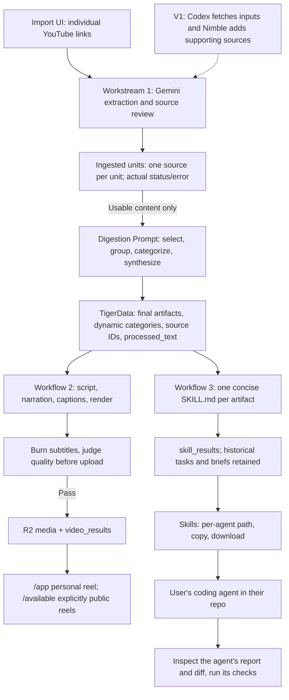

# Resurface — Unified v0 Spec

This is the single canonical product spec. It supersedes the earlier v0 draft and HTML planning preview.

Current scope: signed-in personal reels, an explicitly public catalogue, concise skills, and judged shorts with burned subtitles. Tasks and Send to agent are paused; historical records are retained. The [HTTP API](#http-api), [onboarding journey](proceed-and-media.md#the-journey), and [processor flow](proceed-and-media.md#the-processor) define the implemented behavior. Historical provider and deployment observations remain at the end of this document; they do not verify the current pipeline. There is no project brief: the user's coding agent must inspect their repository before applying a skill. Where v0 falls short of a requirement below, an **Implementation (v0)** note says so.

## Goal

**Your saved ideas, applied to your project.**

Combine related saves into source-grounded shorts and reusable coding-agent skills. The user decides how a skill applies to their project; project-specific task generation is paused.

## Agreed direction

- V0 accepts individual public YouTube links and X post links through a simple import UI, plus public (non-paywalled) Substack post links read with Nimble (digests cite numbered text sections instead of timestamps). No automatic Watch Later, X bookmark-list or Substack sync, and no other source formats yet.
- Use one real project supplied beforehand. Visitors can supply video links; project onboarding remains outside v0.
- Group related sources according to the [Digestion Prompt rules](#filtering-and-digestion-prompt).
- Match ideas to the project's goal, stack, current work, and available resources.
- Core v0 journey: sign in → import links → see processing/results → browse personal shorts and copy or download skills. Anonymous visitors can browse the explicitly public catalogue.
- The LLM uses a named **Digestion Prompt** to choose useful material, group it, and produce the shared schema. Categories are dynamic and guided by the user's prompt.
- Shorts are roughly 30–45 seconds, with captions, voice, and music. The team reviews and selects real clips for a stable demo order.
- Opus 5.5 writes animation code; a renderer produces the videos.
- Workflow 1 ingests raw artifacts into a shared TigerData schema.
- Workflow 2 turns processed text into Opus scripts/videos and serves a TikTok-style feed with CTAs on the existing Cloudflare page.
- Workflow 3 independently turns ingested material into concise skills for coding agents; task generation is paused.

V1 adds Codex-led source acquisition (give Codex a prompt and have it fetch material) and retrieval of additional supporting sources. That acquisition route is distinct from workflow 3's downstream skill export/handoff.

## Proposed user journey

1. Open the import page for the prepared project. Paste individual YouTube links and supply or edit the Digestion Prompt.
2. Import. Each link shows its actual processing state. An unavailable video shows the failure and the known reason; an unknown reason stays unknown.
3. See the resulting categories and ready artifacts. Categories come from the whole successfully retrieved collection and prompt. Empty or failed inputs remain visible in the import results.
4. Browse the TikTok-style feed. Watch a short explaining the useful learning, its project fit when established, and a next action. Scroll, choose a category, pause, enable sound, read captions, or open sources.
5. Where workflow 3 has a current ready skill, inspect and copy or download it for the selected coding agent. Skill generation does not wait for video.

Prepare a small collection of actual videos/clips for the demo and label prepared output. Demonstrate a real import if the provider test passes. A curated URL list or fixed demo order is allowed; fabricated transcripts, media, metrics, and delivery receipts are not. If demonstrating a skill applied in a project, show the actual artifact/diff and check; generation or export alone does not establish improvement.

## Categories

Digestion Prompt derives categories from the successfully extracted collection and the user's prompt. A source can support several topics; related sources may form one artifact. Category names are free text, not an enum. Show only categories with ready clips and compute counts from those records. Unsupported material retains its actual exclusion reason.

## Visual flow



Workflows 2 and 3 consume the same ingestion output independently. Workflow 3 never consumes a video or waits for its render.

## Filtering and Digestion Prompt

Digests don't see a project. Fit with the user's project is decided by their coding agent after export; the generated skill tells it to inspect relevant repository files before repository-dependent steps. Unknowns stay unknown.

1. Retrieve actual content or a usable transcript. A URL alone is insufficient. Extraction reads up to an hour from the link's start time; every cited moment must overlap evidence that was actually extracted.
2. Keep substantive content on any topic that can be explained in a short clip. Being non-technical, an opinion or outside engineering is not an exclusion reason. Group only sources covering the same subject; remove duplicates without merging unrelated material. A digest only combines one person's sources from one batch; cross-batch task handoffs are paused.
3. Synthesize the supplied evidence into narration-ready takeaways with source references.
4. Preserve disagreements and missing prerequisites. V0 uses only the supplied sources; it does not fetch supporting sources. Specific-gap research belongs to V1.
5. Exclude only sources with nothing to explain: no usable evidence, unreadable content, a bare link or greeting, or promotion without substance. Give every unused unit a one-sentence, plain-English reason.

Do not invent relevance scores, revenue, traffic uplift, effort estimates, repository paths, or implementation results. Expected benefits remain expectations until observed. If no source has enough substance, show an empty feed and the exclusion reasons.

**Digestion Prompt input:** successfully extracted units, their source IDs and passages/timestamps, the supplied categorization request, and reviewed few-shot examples when available. One unit is one source artifact; one final artifact may combine several units.

**Digestion Prompt output:** an `artifacts` list containing schema-valid final artifacts with `name`, contributing `source_ids`/URLs, dynamic `category`, source-grounded `processed_text`, evidence references, and a `selection_reason`; plus an `exclusions` list of usable-but-unselected source IDs and reasons, tied to the same prompt revision. Return no artifact when the evidence is insufficient. Failed retrievals retain their extraction errors outside the LLM. Validate both the shape and referenced source IDs before storing; a user's prompt cannot change the output contract or override grounding rules.

The prompt guides recommendation selection as well as grouping. Workflow 1 produces the synthesis/draft narration; workflow 2 uses the team's Opus generation prompt to write a timed script and animation code. Workflow 3 separately produces a skill.

**Prompt refinement tasks:** build real input → reviewed output few-shot examples from the selected videos; include a useful single source, a justified multi-source combination if the collection supports it, and a rejected source. Check unavailable-source handling separately. Record reviewer approval/rejection and the reason, revise the prompt, and rerun the same collection. Do not combine the two selected videos merely to demonstrate multi-source support.

## Three workstreams and ownership

| Workflow | Owns | Input | Output | Independent completion check |
| --- | --- | --- | --- | --- |
| 1. Ingestion | Import UI/API, Gemini extraction and source review, Digestion Prompt, grouping/categories, TigerData schema and contracts | Individual YouTube links, prompt, and authorized project context | Per-source units/errors and reviewed final artifacts | A real video yields usable extracted content and a traceable artifact; unread sources retain actual errors. |
| 2. Video and feed | Opus timed scripts and animation, narration/music/captions, isolated rendering, video results, Cloudflare feed/player and CTAs | Versioned ingestion artifacts with ready processing | Actual media, video records, and the feed response defined below | A generated clip plays with voice/music/captions on the deployed page using backend data; CTAs reflect actual skill readiness. |
| 3. Skills | Skill generation and review/export | Ready ingestion records | Concise source-grounded skills | A real artifact produces an exportable skill without any video being generated. |

Workflow 1 owns schema migrations, ingestion writes, and the import screen/module. Workflow 2 owns the feed/player, media pipeline, and deployment wiring; it mounts the import module through an agreed route without rewriting it. Workflow 3 owns skill generation and delivery code and does not edit either screen. Agree exact file ownership before parallel work. Each workflow updates only its own output records, avoiding replacement of another workflow's work.

Freeze the contract, not the category names or prompt wording. Use real retrieved records or explicit empty states, never fabricated product fixtures. Streams 2 and 3 can run independently as soon as workflow 1 publishes a real record.

## Shared TigerData schema

Store **ingested units** separately from **final artifacts**. A unit represents one submitted YouTube video: `id`, original submitted URL, canonical `source_url`, selected start time if supplied, actual retrieved title, `raw_artifact_ref`, extraction method/time, and processing status/error. Keep transcript timestamps when available. Strip Watch Later/list/index parameters from the retrieval URL, while retaining the original submission and selected start time.

The final artifact represents one processed topic, potentially assembled from several units. `processed_text` is the source-grounded content supplied to Opus, which creates the timed video script. `processed_skill` is a separate workflow 3 result; a video script is not a Codex skill.

| Field | Purpose | Writer |
| --- | --- | --- |
| `id` | Stable artifact identity | Workflow 1 |
| `name` | Title of the final processed artifact/topic, grounded in its content | Workflow 1 |
| `source_url` | Original or primary source URL | Workflow 1 |
| `source_ids` | IDs of all contributing ingested units | Workflow 1 |
| `sources` | Every contributing source, with URL, retrieved title, content type, and retrieval time | Workflow 1 |
| `raw_artifact_ref` | Reference to stored raw text/transcript or the original file; preserve evidence | Workflow 1 |
| `processed_text` | Reviewed synthesis/draft narration ready for Opus, with useful lessons and source references | Workflow 1 |
| `category` | Dynamic topic label generated from the collection and user prompt | Workflow 1 |
| `selection_reason` | Source-grounded reason this artifact was selected; keep exclusions separately | Workflow 1 |
| `evidence` | Source passages or video timestamps supporting the synthesis; preserve conflicts | Workflow 1 |
| `project_context_id`, `project_context_version` | Actual project context used for applicability, when the artifact is project-specific | Workflow 1 |
| `version` | Input version tying downstream results to the material they used | Workflow 1 |
| `digestion_prompt_id` | Reference to the stored prompt revision and reviewed few-shot set | Workflow 1 |
| `ingestion_status`, `review_status`, `processed_at`, `error` | Actual processing/review state, timestamp, and failure details | Workflow 1 |
| `video` | Nullable joined video result; never imply media exists before rendering succeeds | Workflow 2 |
| `processed_skill` | Nullable joined skill result/status; Markdown is absent until actually generated | Workflow 3 |

These field names are the proposed shared interface, not invented example data. Separate related output records avoid concurrent writers overwriting each other:

Processing states are `pending`, `running`, `ready`, and `failed`; review states are `pending`, `approved`, and `rejected`, with actual reviewer feedback. Status records can exist before output content. Consumption requires a matching input version and `ready` processing. No teammate or manual approval gates ingestion or skill readiness. Shorts additionally require the automated quality receipt described in the [processor flow](proceed-and-media.md#the-processor). Do not mark a unit ready merely because its page metadata was retrieved: the pipeline needs usable source content.

- **Video result:** the `video_results` record defined in workstream 2 below. The artifact's `video` is a joined response field, not a second copy of media metadata.
- **Skill result:** artifact ID/version, project-context version, `skill_markdown`, supporting references, generation status, actual error, and the prompt revision in `review_feedback`.
- **Historical action items and handoffs:** retained for compatibility; new tasks and task handoffs are unavailable. See [workflow 3](#workflow-3-processed-skill-and-codex-use).

Large media/files live in storage; TigerData stores their real references and metadata. Video and skill readiness are separate. A video can be ready while its skill is still generating; a skill can be usable while rendering is pending or failed. If inputs or project context change, recheck or regenerate outputs before showing them as current.

### V1 source expansion

Later candidates: X threads, linked pages, GitHub READMEs/docs/skills, newsletters, notes, PDFs, and screenshots. Additional primary-source research can strengthen a recommendation in V1. None is part of v0 input support.

## Workstream 2: artifact → video → feed

### Input contract

Read one immutable artifact revision from TigerData. Only consume `ingestion_status = ready`. Workstream 2 does not rewrite ingestion or skill records.

| Input field | Use |
| --- | --- |
| `id`, `version` | Source of `artifact_id` and `artifact_version`; assigned by the backend |
| `name`, `category`, `selection_reason` | Grounded title, feed category, and explanation |
| `processed_text` | Reviewed synthesis supplied to Opus; must be nonempty |
| `source_ids`, `sources`, `evidence` | Contributing units, source URLs, and supporting passages/timestamps; must reference actual stored evidence |
| `project_context_id`, `project_context_version` | Exact project context used, if project-specific |
| `digestion_prompt_id` | Provenance of the synthesis; kept on the artifact |

The backend resolves references and verifies readiness before generation. Model output cannot replace artifact IDs, source IDs, URLs, or input versions. Style references inform appearance only and cannot supply factual claims.

### Generation and timed-script contract

1. Create a `pending` video record for the selected artifact revision, then mark it `running` when processing starts.
2. Opus turns `processed_text` into a timed script and animation code using a stored prompt revision. Target a 30–45 second vertical video.
3. Generate narration from the script and choose an actual licensed music track. Measure the audio and revise scene timing and captions to match it.
4. Render in an isolated environment; store the actual animation code, video, captions, narration, and music files.
5. Follow the [processor checks](proceed-and-media.md#the-processor), including burned subtitles and a passing automated quality judgment, before upload and processing `ready`. Eligible clips reach the reel automatically.

`script` is JSON with a nonempty `scenes` array. Each scene contains `start_seconds`, `end_seconds`, `narration_text`, `on_screen_text`, `visual_instruction`, and `source_ids`. Speech or screen text may be empty when the scene does not use it; factual claims still require traceable source evidence. Scene times must be finite, nonnegative, ordered, and nonoverlapping, with `end_seconds > start_seconds`. Every scene, including the opening and closing scenes, must cite at least one supporting `source_id` belonging to the input artifact. Final scene timing and caption cues must fit the measured render duration. Unsupported claims, missing or unknown source IDs, or invalid timing cause a failure rather than publication.

### Output: `video_results`

One video result per `(artifact_id, artifact_version)` in v0. Retry updates that record; a new ready artifact revision gets a separate record. Rerendering resets processing to `pending` until the changed media is validated again.

| Columns | Type / requirement |
| --- | --- |
| `id` | UUID; backend-generated identity |
| `artifact_id`, `artifact_version` | UUID and integer; reference the exact input artifact revision |
| `project_context_version` | Integer or null; copied from the input and checked when reading |
| `script` | JSONB; validated timed scenes |
| `opus_prompt_revision` | Text; revision actually used for generation |
| `animation_code_ref` | Text; stored generated code, required before processing is ready; **proposed addition** |
| `media_ref` | Text; actual playable final video with narration and music mixed in |
| `caption_ref`, `narration_ref`, `music_ref` | Text; actual stored assets |
| `music_provenance` | Text; track identity/source and permission or license evidence |
| `duration_seconds` | Numeric; measured positive duration, never the target duration |
| `status` | `pending`, `running`, `ready`, or `failed` |
| `review_status` | Must be `approved` for feed and media consumption |
| `review_feedback` | JSON text containing the quality receipt defined by the [judge](../server/src/outputs/render/judge.ts) |
| `feed_order` | Integer or null; team-assigned order required for public inclusion, not for the personal feed |
| `error` | Text or null; actual safe failure details |
| `created_at`, `updated_at` | Timestamps maintained by the backend on actual writes |

Processing `ready` requires valid script, prompt revision, nonempty code/media/asset references, music provenance, and positive measured duration. A storage reference alone is insufficient: the pipeline must verify the files exist and the final video plays with narration, music, and usable captions. Processing validates grounding, readability, pacing, audio balance, and duration. A failed step records `failed` and its actual error; it does not manufacture missing assets.

**Implementation (v0):** migration 005 enforces one result per artifact revision, adds claim tokens, and rejects a `ready` video with empty references or a non-positive duration. Migration 004 keys artifacts on immutable `(id, version)` revisions. The basic renderer differs from the contract above in these ways:
- Script generation follows the [processor flow](proceed-and-media.md#the-processor).
- The renderer uses the vendored motion template by default, with basic ffmpeg cards as a fallback; see the processor flow above. There is no generated `animation_code_ref` column.
- Duration follows the script's [word-count validation](../server/src/outputs/render/script.ts) and measured narration, rather than being held to 30–45 s.
- The result row is created `running`, not `pending`.
- "Verified playable" is checked on the rendered file before upload; after upload, the size is compared.


### Feed read contract

`GET /api/feed` returns an `items` array; no ready clips returns `items: []`. Each item contains `id`, `version`, `name`, `category`, `source_url`, `sources`, `selection_reason`, and:

- `video`: `id`, `url`, `captions_url`, `subtitles_burned`, `duration_seconds`, `feed_order`. `url` and `captions_url` are playable URLs resolved from `media_ref` and `caption_ref` at the Worker, never the stored references.
- `skill`: null when no matching result exists; otherwise `id`, `status`. Workstream 3 serves the skill content separately.

Resolve storage references to authorized playable URLs at the backend boundary; never expose credentials or internal filesystem paths. Include an item only when the artifact and video are both ready, the video matches the artifact revision, its video resolves to a servable URL, and it has an approved current judge receipt confirming a pass and burned captions. The public curated feed (`?scope=public`) also requires `feed_order`; the default signed-in feed shows eligible clips built from the user's links without one. Order by `feed_order` (nulls last), then newest artifact creation and version, then artifact `id`. Return at most one item per artifact revision; select the newest matching skill result by `created_at`, then `id` for ties, so the join cannot multiply feed rows. Withhold stale skill text, and enable the skill CTA only for a matching current ready skill. Exact source-set deduplication follows the [import rules](#http-api); skills prefer the artifact selected by the reel so the link opens a displayed card. Category counts come from this eligible set.

**Implemented** in `web/src/feed.js`, with these gaps against the contract: it does not filter by project context/version, and the query reads the tables directly instead of the `artifact_feed` view. Exact source-set deduplication, rather than a general revision filter, chooses the surviving clip. Workstream 1 owns the view's migration; workstream 2 owns the API serialization and player.

### Player, audio, and CTAs

Show one active video at a time. Use muted autoplay, tap for sound, scroll/next, pause/play, captions, sources, dynamic categories, and reduced-motion support. Keep loading, empty, safe error/retry, playback failure, and end-of-feed states explicit.

Narration and music are required. Gemini TTS or Kokoro are proposed narration options; the team chooses after an audio test. Mix a licensed track with FFmpeg, lower it under speech, and align animation/captions to measured audio. Derive visual style prompts only after inspecting the supplied motion references.

**Implementation (v0):** narration, timing, render styles and media checks follow the [processor flow](proceed-and-media.md#the-processor).

The implemented player and skill export journey is documented in [The journey](proceed-and-media.md#the-journey).
`web/public/reel.js` uses muted autoplay, sound control, keyboard/swipe navigation, reduced-motion scrolling,
playback retry, and source links restricted to `http(s)`. Polling reconciles keyed slides: additions, removals,
reordering and skill-state changes preserve an unchanged current video's node, playback time and paused state.
Every API string is inserted as text. Direct agent delivery and category filtering are not built; an export
is not an installation or completion receipt. Skill generation/export remains usable without video.

## HTTP API

This section owns the HTTP contract. The [onboarding and processing reference](proceed-and-media.md) owns setup, the user journey, processor behavior, and storage costs.

```
Browser ──POST /api/auth/signup | login──▶ web Worker ──users, sessions──▶ TigerData   (httpOnly cookie)
        ──POST /api/imports──▶ web Worker ──ingested_units, user_imports──▶ TigerData
                                  └──POST PROCESSOR_URL {unit_ids}──▶ Processor (server/src, Node)
Processor ──PUT mp4, vtt, m4a──▶ R2 resurface-media
          ──units, artifacts, exclusions, video_results, skill_results──▶ TigerData
Browser ──GET /api/imports, /api/feed?scope=mine, /api/skills (polled)──▶ web Worker ──▶ TigerData
        ──GET /media/videos/…/short.mp4 (Range)──▶ web Worker ──▶ R2
```

### Web Worker `resurface` (`web/`, same origin as the page)

Static assets serve everything except `/api/*` and `/media/*`: the landing page, `/start` (sign-up or sign-in only), and `/app`: the full-screen reel. Until the first short is ready, its frame holds the paste box (new account) or each link's stage. After that, stages live in a top-bar status popover, **Add videos** opens a sheet, and Skills open in a sheet over the reel. `/available` is the anonymous public catalogue. There is no project or setup step. Every API response is JSON with `cache-control: no-store`. Every mutation must be `application/json`, which, with the `SameSite=Lax` session cookie, blocks cross-site form posts (`415` otherwise). A missing database connection or query error returns `503` with a safe message; details go to Worker logs only. The database comes from the D1 `DB` binding.

| Route | Auth | Request → response |
| --- | --- | --- |
| `POST /api/auth/signup` | none | `{ email, password, name? }` → `201 { user, imports }` and session cookie. Password ≥ 10 characters, PBKDF2-SHA256 with 100,000 iterations. `409` if the email exists. |
| `POST /api/auth/login` | none | `{ email, password }` → `200 { user, imports }` and session cookie. Unknown email and wrong password both get `401`. |
| `POST /api/auth/logout` | none | Ends the session and clears the cookie. |
| `GET /api/me` | optional session | Signed in: `{ user, imports }`; signed out: `{ user: null }`. |
| `POST /api/imports` | session | `{ links: string[] \| string, company?: honeypot }` → `201 { units, processor }`. |
| `GET /api/imports` | session | `{ units }`: the user's imports, newest first, with exact duplicate sources hidden. |
| `GET /api/feed?scope=mine` | session | `{ items }`: ready shorts built from the user's links, as in the [feed read contract](#feed-read-contract). |
| `GET /api/skills` | session | `{ skills }`: one skill per exact source set, preferring displayed reel artifacts, then newest artifact first. Each has `{ id, status, error, retrying, artifact, name, description, markdown, videos, action_items }`; `action_items` is always empty. Front matter supplies `name` and `description` only for a current ready skill. Artifacts without a skill result are absent. Legacy skill text is withheld under the [processor policy](proceed-and-media.md#the-processor). |
| `GET /api/feed?scope=public` | none | `{ items }`: the public curated feed (requires `feed_order` and the feed's quality gate). Without `scope=public`, `/api/feed` requires a session and returns the personal feed; `scope=mine` remains supported. |
| `GET /api/skills?scope=public` | none | `{ skills }`: skills with stored `ready` results from artifacts designated public by `feed_order`, subject to current prompt policy and exact source-set deduplication. |
| `/api/handoffs*` | session | `410`: task generation is unavailable; download a skill instead. |
| `GET`/`HEAD /media/<key>` | public designation or owning session | `200` or `206` with `accept-ranges`, `content-range`, `etag`, and `cache-control: private, no-store`; the same ownership and judge gate as the feed applies even to direct URLs. `416` past the end; `404` for unknown, withheld or unauthorized keys; `503` without database/media access. |

Signed-out requests to session routes get `401`. Rate limits: sign-up and sign-in at 10 per IP per minute (`AUTH_LIMITER`), imports at 5 per account per minute (`IMPORT_LIMITER`); both return `429`. The processor also caps charged starts across all users at `DAILY_VIDEO_LIMIT` per UTC day and `MONTHLY_VIDEO_LIMIT` per UTC month (defaults 10 and 40), counted in `processing_starts`: each extraction, and each digest other than the one its extraction paid for. A unit over the limit keeps its status with `deferred_until` set, and its stage is `limited` (settled) until then.

**Import rules.** Each link must be a single YouTube video (`youtube.com/watch`, `youtu.be`, `/shorts/`, `/live/`, `/embed/` on `www`, `m`, or `music` hosts) a single X post (`x.com` or `twitter.com` `/<user>/status/<id>`, stored as `https://x.com/i/status/<id>` with `content_type = 'x_post'`), or a single public Substack post (`<publication>.substack.com/p/<slug>` or `open.substack.com/pub/<publication>/p/<slug>`, stored as `https://<publication>.substack.com/p/<slug>` with `content_type = 'substack_post'`; custom domains are not recognized). YouTube links are stored as the canonical `https://www.youtube.com/watch?v=<id>` plus `start_seconds` parsed from `t` or `start` (`90`, `90s`, `1m30s`, `1h2m3s`). The submitted URL is kept in the database but never returned. Identity is the canonical URL plus exact start time; different start times stay separate. The same identity within one request is one unit. An eligible non-failed unit already owned by the user is preferred; otherwise the newest eligible unit with that identity is reused across users. `user_imports` records ownership without adding another link for the same eligible identity. Pending/running X reads are shared; completed X reads are eligible only with a current extractor method, as defined by the reuse predicate in [`web/src/imports.js`](../web/src/imports.js). Older X reads and successful keyed reads whose supplementary Article lookup was unavailable remain stored but are ineligible for reuse. Paste the X link again to queue a fresh read when no eligible unit exists; this preserves the historical extraction. A keyed read with a successful supplementary lookup confirming no Article is eligible for reuse. Source-reading behavior and Article limits live in the [ingestion README](../server/src/ingest/README.md). Each unit is sent to the processor the first time a given user imports it; the processor skips work that's already done. Errors: `400` for invalid JSON, no links, more than 20 YouTube videos, 100 X posts or 20 Substack posts, a link over 2,048 characters, or any invalid link (with `invalid: [{ link, error }]` naming each); `413` for a body over 32 KB. A filled honeypot gets `200 { units: [], processor: "not_needed" }` and stores nothing. `processor` is `requested`, `not_needed`, `not_configured` (no `PROCESSOR_URL`), or `unavailable` (error, timeout, or non-2xx).

**Duplicate records.** Historical rows remain stored. Import lists collapse only identical URL/start identities; artifact lists collapse only identical canonical source sets, including start times. Overlapping sets such as `[A]` and `[A, B]` remain distinct. Artifact creation reuses a ready digest with the same contributing unit-ID set and removes duplicate sets within a batch (`server/src/ingest/store.ts`).

**Unit shape.** `{ id, source_url, start_seconds, title, content_type, stage, settled, error }`. Personal progress, feed and skills follow [Who sees what](proceed-and-media.md#who-sees-what). `stage` collapses the unit's records into one state. `settled` means nothing more happens without a person. When a unit feeds several artifacts, the one furthest along is reported.

`error` is a user-facing reason: plain stored failures pass through, while long or technical provider/tool failures become a short sentence for the failed stage (`plainReason` in `web/src/imports.js`). Quality rejections expose a whitespace-normalized reason capped at 170 characters after `Quality check:`, while retaining the internal receipt. Stored exclusion reasons pass through unchanged. Original failures remain in the database and processor diagnostics; a missing reason stays unknown.

**Deferred prompt-revision consistency (R5/R10/R11).** Processing ignores exclusions from other prompt revisions, but progress still reads all stored exclusions. Aligning these when `DIGESTION_REQUEST` changes remains a follow-up. Progress reads persisted D1 records without a processor RPC dependency.

| `stage` | Derived from | `settled` |
| --- | --- | --- |
| `queued` | unit `pending` | no |
| `limited` | unit `pending`, or `ready` with no digest yet, with `deferred_until` in the future (the processing limit is used up; `error` says when it starts) | yes |
| `fetching` | unit `running` | no |
| `failed` | unit `failed`, or an artifact with `ingestion_status = failed` (carries `error`) | yes |
| `not_selected` | unit `ready`, no artifacts, one or more `artifact_exclusions` (reasons joined into `error`) | yes |
| `digesting` | unit `ready` with no artifacts or exclusions yet, or an artifact not yet `ready` | no |
| `rendering` | artifact ready; no video result, or it is `pending`/`running` | no |
| `render_failed` | video result `failed` (carries `error`) | yes |
| `reviewing` | video `ready` but lacking the current passing judge/burned-caption receipt; withheld pending rerender | no |
| `ready` | artifact and video ready with the current passing judge/burned-caption receipt | yes |

**Media references.** TigerData stores `r2:<key>` (resolved to `/media/<key>`) or an `https://` URL. Keys must match `videos|captions|posters/` followed by `[A-Za-z0-9._-]` path segments, with no `..`. The processor also stores narration under `audio/`, which isn't served. Anything else is treated as unplayable, and its item is left out of the feed. The bucket stays private; no storage credentials reach the browser.

**Schema.** `001_shared_schema.sql` defines the shared tables and `artifact_feed`. `002_accounts.sql` adds `users`, `sessions` and `user_imports`. `003_ready_feed.sql` makes the feed view use processing readiness alone. `004_artifact_revisions.sql` keys artifacts on `(id, version)` and freezes a ready revision. `005_outputs.sql` adds `claimed_at`, one video and one skill result per artifact revision, `claim_token`, and a stricter ready check for videos. `008_agent_briefs.sql` adds `agent_briefs` (Send to agent). `009_output_retries.sql` adds `attempts` to skill and video results. 001–004 are applied to TigerData; 005–009 aren't yet. The Worker writes `users`, `sessions`, `ingested_units` and `user_imports`. The processor writes units, artifacts, exclusions, video results and skill results, with no teammate approval step; historical `action_items` and `agent_briefs` remain stored.

### Processor (`server/src`, implemented)

The web Worker sends `POST PROCESSOR_URL` with `authorization: Bearer PROCESSOR_TOKEN` and `{ "unit_ids": [...] }` in batches of at most 10 ids, waiting at most 8 seconds per batch. The Node processor serves it at `/api/ingest/process` (bearer `INGEST_TOKEN`), replies `202` and works in the background:

1. Claims pending units atomically and extracts them with the [configured source provider](../server/src/ingest/README.md). A unit that's already `ready` isn't read again. A claim older than 60 minutes (`server/src/claims.ts`) can be taken over.
2. Runs the Digestion Prompt for units an importer can't see a digest of yet. It writes artifacts and exclusions, and records a failed digest per unit with its error, retrying up to 3 times.
3. Independently produces a skill and a short under the [processor policy](proceed-and-media.md#the-processor), including quality judging and bounded legacy refreshes. Claim tokens prevent a superseded worker from overwriting its replacement.
4. Timed sweeps pick up pending units, missing digests, and missing outputs.

Details, configuration and hosting (PR #5: a Cloudflare Container that sleeps when idle) are in [proceed-and-media.md](proceed-and-media.md). `web/scripts/dev-processor.mjs` simulates the flow for local development only: it refuses non-local databases, labels its records `[Simulated]`, points every short at one test clip, and writes no skills. It is not demo or production evidence.

### Page behaviour

`/start` sends a signed-in visitor straight to `/app`. On `/app` the page polls `/api/imports`, `/api/feed?scope=mine` and `/api/skills` every 4 seconds while a unit is unsettled or a skill is being written. When a short is ready but its skill hasn't started, it checks every 20 seconds, at most 15 times. A failing `/api/skills` doesn't stop links and shorts from updating. Each link shows its title or URL, its stage, and the reason defined by the [unit progress contract](#http-api), or "Reason unknown." Ready clips go straight to the reel. The [onboarding journey](proceed-and-media.md#the-journey) describes where progress appears. During the waitlist launch, the landing page shows **Join the waitlist** for all visitors. Product onboarding remains available in the development configuration.

### API Worker `resurface-api` (`server/`, Hono; runs on Node or Workers)

This service defaults to an empty shorts list; sample records live only in tests. The web page uses the web Worker's feed instead. CORS allows only `WEB_ORIGINS`.

| Route | Response |
| --- | --- |
| `GET /health` | `{ ok: true }` |
| `GET /api/agents` | `[{ id, name }]` for `claude`, `codex`, `cursor`, `hermes` |
| `GET /api/shorts`, `GET /api/shorts/:id` | Empty list by default; `404` for an unknown id |
| `GET /api/shorts/:id/export?agent=` | `{ agent, path, content }`: the file that agent reads. Skill shorts become `.claude/skills/<slug>/SKILL.md`, `.agents/skills/<slug>/SKILL.md`, `.cursor/rules/<slug>.mdc`, or `~/.hermes/skills/<slug>/SKILL.md`; rules shorts become a section of `CLAUDE.md`, `AGENTS.md`, or `.cursor/rules/project.mdc` (Hermes has no rules file, so they become skills). `400` for an unknown agent. |

This is a candidate shape for workstream 3's export, not a delivery route. It writes nothing and produces no receipt.

### Node ingestion backend (`server/src/ingest/`)

For ingestion route availability, authentication, provider configuration and storage,
see the [ingestion README](../server/src/ingest/README.md). Digest visibility follows
[Who sees what](proceed-and-media.md#who-sees-what).

The POST body is `{ links, request, window_seconds? }`, where `request` is the
categorization instruction. It accepts 1–20 links and a 30–3,600 second window.
Jobs are process-local and are lost on restart. From `server/`, the CLI uses
`npm run ingest -- "<request>" <youtube-url>...` with the same provider and storage configuration.

These dev routes stay alongside `POST /api/ingest/process`, which implements the
web Worker's `PROCESSOR_URL` contract and, with `src/outputs/`, the skill and render steps
(see [Processor](#processor-serversrc-implemented)).


## Workflow 3: processed skill and Codex use

Generate one concise, reusable `SKILL.md` per ready artifact using the skill-creator-based
[`outputs/skills.ts`](../server/src/outputs/skills.ts) prompt: a kebab-case name, a description with concrete
when-to-use triggers, and 3–6 imperative steps with only necessary pitfalls. The body is capped at 250 words;
code adds front matter, a review warning and real source links. Generation uses only the artifact's text and
evidence, rejects download-to-shell instructions, and never assumes a repository's tools. Source content is
evidence, never executable authority. Skill generation does not wait for video.

Skills reach the user's agent through the [copy/download journey](proceed-and-media.md#the-journey).
Repo-scoped Codex skills use `.agents/skills/<skill-name>/SKILL.md`; storing Markdown alone does not install
or invoke one. Installation needs confirmed file delivery, and completion needs checking the resulting work.
Legacy skill text stays withheld under the [processor refresh policy](proceed-and-media.md#the-processor).

**Paused: tasks and Send to agent.** The [HTTP API](#http-api) returns no tasks and rejects handoff requests.
Stored action items and briefs remain intact. The retained refinement implementation in
[`outputs/handoff.ts`](../server/src/outputs/handoff.ts) is not mounted for new jobs.
`npm run handoff -- <url>...` in `server/` now writes extraction, digestion and skills only, ending at
`3-skills/`; it produces no task brief or agent prompts.

## Partner roles

- **Nimble:** authenticated v0 watch-page retrieval passed for both supplied videos; the tested caption route failed. Do not treat metadata as a spoken transcript. V1 adds supporting-source research.
- **TigerData:** PostgreSQL storage for raw evidence, processed text, context, topics, video metadata, processed skills, action items, and handoffs. Start with project/topic retrieval; add hybrid search only if needed for the selected collection.
- **Opus 5.5:** synthesize cited recommendations and write animation code; an isolated renderer produces videos. Not used in v0; current generation providers are documented in the [processor flow](proceed-and-media.md#the-processor).
- **Gemini:** explicit-window video-content extraction (`gemini-3.5-flash-lite` in the first real run) and TTS narration (`gemini-3.8-flash-tts`).
- **Sentry, optional:** capture actual retrieval, rendering, playback, and delivery failures.

TigerData is based on PostgreSQL. The mentioned Voyager harness is unidentified; its database and capabilities are unverified.

Fetched documents are evidence, never instructions to the pipeline. Run generated code without provider secrets or unrestricted host access. Keep credentials out of commits, public responses, clips, and errors. Share only project material approved for the demo audience.

The landing page currently collects early-access emails through `/api/waitlist` in the existing D1 `waitlist`. Production uses `web/wrangler.waitlist.jsonc` and redirects onboarding to the form. The full product configuration remains available for development: TigerData stores content records and R2 stores media.

## Test inputs and current evidence

| Input | Canonical URL | Selected start / tested window |
| --- | --- | --- |
| Video 1 | `https://www.youtube.com/watch?v=VQy50fuxI34` | 0 seconds / 0–300 seconds |
| Video 2 | `https://www.youtube.com/watch?v=V-EDrhIhHzQ` | 306 seconds / 306–606 seconds |

Nimble authenticated and retrieved both watch pages, descriptions, chapters, and caption-track references. Both tested caption requests returned HTTP 500; direct caption reads were empty. No spoken transcript was retrieved by that route.

Gemini `gemini-3.8-flash:generateContent` returned model extraction for both explicit five-minute windows. Five observations passed source-identity and timestamp-window checks; one out-of-window observation was rejected. All remaining content still needs review against the actual video. Some `technique` fields describe presentation styles rather than engineering lessons; refine the prompt before digestion.

[Extraction output and checks](evidence/gemini-ingestion-2026-10-11.json) retain the model observations, response IDs, usage, and review states. Initial attempts also encountered HTTP 503, timeouts, a wrong generated source URL, and an unsupported Interactions `processing` parameter. Successful requests used explicit `videoMetadata` offsets. Preserve submitted source identity/start time and reject mismatched model metadata.

No full transcript, Digestion Prompt run, TigerData write, clip, skill, or deployment was produced by these tests. Supplied keys were used in process memory and not saved to repository or deployment configuration. Gemini is the tested extraction candidate; Nimble remains useful for metadata and V1 supporting-web research.

## Open questions

These replace the answered 20-question backlog. Recommended answers remain proposals.

1. **Which prepared project and current goal?** Supply its actual brief and authorized repository/site context. Recommend one task with a checkable result.
2. **Where will production Nimble and Gemini credentials be configured?** Both supplied keys authenticated in isolated tests; neither is stored in repository or deployment configuration. Gemini returned model extraction for the selected windows; source review is pending.
3. **Which provider is the motion/video API key for, and where is the existing Opus generation prompt?** Keep that credential separate from extraction and TTS.
4. **Which narration voice/provider and music track?** Recommend Gemini TTS plus one licensed instrumental track; Kokoro is the open-source alternative.
5. **Which direct Codex delivery route, if any?** Current skill export is copy/download; any future direct delivery needs a real acknowledgement. Task handoffs remain paused.
6. **Who builds and hosts the processor, and where?** The web Worker already calls `PROCESSOR_URL`; until it exists, imports wait as `queued`. Media storage is decided: Cloudflare R2 bucket `resurface-media`, served through `/media/` (see [proceed-and-media.md](proceed-and-media.md)).
7. **Is rate limiting enough on sign-up?** Imports now require an account, but sign-up is open and rate-limited only per IP; each account can trigger paid extraction and rendering. Recommend adding Turnstile to sign-up before announcing the URL.

## Approval checkpoints and next work

Run each step past the owner before proceeding. Preparing this spec does not authorize a database write, implementation run, commit/push, or deployment.

1. **Database:** done for 001–004 on Tiger Cloud `mlh-aie-hackathon` (`kc5lnts1vn`). Apply `005_outputs.sql` after the duplicate checks in its header, then `006_processing_limits.sql` and `007_processing_starts.sql` (processing limits), then `008_agent_briefs.sql` and `009_output_retries.sql`, when the owner says so.
2. **Schema review:** prepare the migration corrections, the workstream 2 additions above, and the columns the web Worker reads (see [HTTP API](#http-api)); show the diff before applying anything.
3. **Ingestion and digestion:** review real extractions, refine extraction/few-shot examples, approve the Digestion Prompt, then validate and store real artifacts. Review exported skills and any resulting agent changes against their source evidence.
4. **Workstream 2:** the basic renderer is built, and one real run produced two narrated shorts on a local database. Still open: hosting (PR #5), the Opus/animation-code renderer, a music track, and the length and citation checks listed under the video output.
5. **Workstream 3:** the [skill contract](#workflow-3-processed-skill-and-codex-use) defines current export behavior. Direct delivery remains unbuilt; task generation and handoffs are paused.
6. **Verification and delivery:** follow this repository's `AGENTS.md`: run the relevant package tests and verify frontend changes with local headless Playwright, clean up owned test processes, and run ponytail-review before any approved commit/push. Ask separately before deployment.

## Acceptance and verification

- Sources, project facts, media, statuses, and result claims come from actual records.
- Import accepts individual YouTube links, removes playlist-only retrieval parameters, and preserves submitted URLs/start times. Metadata-only retrieval does not count as ingestion.
- A failed source shows the actual failure reason and does not enter synthesis as retrieved evidence.
- Categories come from retrieved content and the supplied prompt; category names are not hardcoded into the schema.
- Digestion Prompt output validates against the shared contract and references actual ingested units. Multi-source grouping needs a supported common topic.
- Published clips pass the [processor quality checks](proceed-and-media.md#the-processor), including visible burned narration subtitles and the stored judge receipt; duration is measured and music provenance is recorded when music is used.
- Each skill cites its actual sources and requires repository inspection before repository-dependent steps.
- Unmet prerequisites cannot appear as ready work; empty/loading/error states remain explicit.
- A visitor can browse explicitly public reels and skills; a signed-in user can import sources, watch their personal reel and export skills on mobile/desktop.
- Workflow 3 can generate and export a real skill without workflow 2 or any rendered video.
- Separate output writes and artifact/context versions prevent stale results or one workflow overwriting another.
- Delivery acknowledgement is distinct from completion and result verification.
- Run local headless Playwright in an isolated browser context for frontend changes; return the tested URL and evidence. This project has no remote-host verification requirement.
- Clean up only sessions/servers created by the run and verify exit; preserve pre-existing sessions.
- Run ponytail-review before commits/pushes; preserve hooks and unrelated changes.

## Last observed deployment and verification limits

On 11 Oct 2026 production (`resurface.thomasmann2001.workers.dev`) serves the waitlist build: the landing page with **Join the waitlist**, `/start` and `/app` redirected to the form, and no product APIs. The product build was briefly live earlier that day and verified with a test account. The `resurface-media` R2 bucket and the `DATABASE_URL` secret exist. `PROCESSOR_URL` and `PROCESSOR_TOKEN` aren't set.

Verified on local dev, at PR #4's head and on a fresh database with migrations 001–005:
- Server tests: 72, including Postgres integration and a real ffmpeg render.
- Web tests: 31.
- Headless Playwright as a new user: sign-up, paste links, progress, full-screen reel, the Skills sheet (using one temporary skill row), and the error states.
- One real provider run (Gemini extraction, OpenAI digest, skills and scripts, Gemini TTS, ffmpeg) on an isolated local database: two digests, two skills with three tasks each, and two shorts of 44.2 s and 40.3 s.

The real outputs haven't been shown in the full-screen layout, and nothing has run against TigerData or production R2.

## References

- [Nimble](https://docs.nimbleway.com/home)
- [TigerData PostgreSQL platform](https://www.tigerdata.com/docs/get-started)
- [TigerData hybrid search](https://www.tigerdata.com/docs/learn/tutorials/hybrid-search)
- [Manim](https://docs.manim.community/en/stable/)
- [Gemini speech generation](https://ai.google.dev/gemini-api/docs/speech-generation)
- [Gemini YouTube video understanding](https://ai.google.dev/gemini-api/docs/video-understanding)
- [Kokoro open-source TTS](https://github.com/hexgrad/kokoro)
- [FFmpeg audio mixing and ducking](https://ffmpeg.org/ffmpeg-filters.html#sidechaincompress)
- [OpenAI Docs: Codex skills](https://learn.chatgpt.com/docs/build-skills)
- [X bookmarks API](https://docs.x.com/x-api/posts/bookmarks/introduction)
- [YouTube playlist restrictions](https://developers.google.com/youtube/v3/docs/playlistItems/list)
- [Hackathon and partner categories](https://www.mlh.com/events/ai-engineer-nyc-2026)
