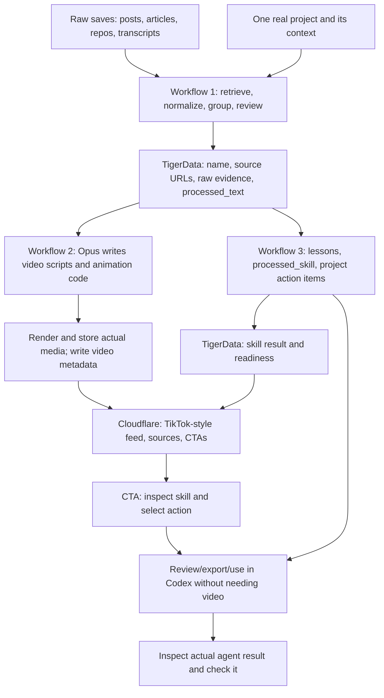

# Resurface v0 — Draft Spec

Status: three-workflow structure and preparation model agreed. Schema and delivery details below are proposed contracts; this spec update does not implement the workflows.

## Goal

**Your saved ideas, applied to your project.**

Combine related saves, match them to what an AI engineer is building, and turn the useful parts into actions. A short explains the recommendation. The useful result is a project-specific task backed by sources.

## Agreed direction

- The team supplies real bookmarks before the demo.
- Use one real project supplied beforehand. Visitors do not import their own saves or projects in v0.
- Combine related bookmarks and tutorials instead of producing one short per link.
- Match ideas to the project's goal, stack, current work, and available resources.
- Desired journey: short → checklist → agent handoff.
- Opus 5.5 writes animation code; a renderer produces the videos.
- Workflow 1 ingests raw artifacts into a shared TigerData schema.
- Workflow 2 turns processed text into Opus scripts/videos and serves a TikTok-style feed with CTAs on the existing Cloudflare page.
- Workflow 3 independently turns ingested material into processed skills and project action items for Codex.

Action selection and Codex handoff are now part of the requested design. The exact delivery route remains open; neither is implemented by this document.

## Proposed user journey

1. Open the prepared project and see its real goal.
2. Browse recommendations grouped by topic.
3. Watch a short: what the combined sources teach, why it fits this project, and what to do next.
4. Open up to three supported actions, with evidence and a way to check the result.
5. Choose an action and inspect the task for the agent.
6. Use the selected skill and action items in one supported Codex destination. Show delivery after acknowledgement and completion after checking the actual result.

Analysis and clips can be prepared beforehand; label them as prepared. Selection and delivery should happen live once their integration works. The demo payoff is a useful change in the real project: show its artifact or diff and the relevant check. Video generation or prompt delivery alone does not establish improvement.

## Categories across the collection

Classify retrieved ideas, then combine those addressing the same project problem. One source can support several topics. Product categories appear only when they contain real, ready recommendations.

| Topic | Candidate material | Evidence status |
| --- | --- | --- |
| Agent workflows | Planning, testing, routing, architecture, reusable judgment | Matt Pocock, pstack, and Kun Chen were read. Recommendations are not yet extracted or tested. |
| SEO and distribution | SEO page techniques and related tutorials | User-described topic; X content and link-to-topic mapping remain unverified. |
| Building apps | iOS guides and implementation ideas | User-described topic; specific source and project fit need confirmation. |
| Local AI and infrastructure | Trying tools on an available device | User-described example involving 0xSero; content and requirements unverified. |
| Business growth | Applying learnings from Ernesto's post | User-described example; the meaning of “zero to 150” and its evidence are unverified. |
| Hardware | Pocket Charm and device-specific ideas | User-described example involving witcheer. Exclude from actionable recommendations when the required device is absent. |

These are proposed categories, not assertions about unread posts. Engineering subtopics can remain tags within Agent workflows.

## Visual flow

Workflows 2 and 3 consume the same ingestion output independently. Workflow 3 never consumes a video or waits for its render.

## Filtering and supporting research

Use an explicit project brief plus authorized repository/site material. Record the goal, relevant implementation facts, current blocker, available tools/devices, constraints, and where each fact came from. Unknowns stay unknown.

1. Retrieve actual content or a usable transcript. A URL alone is insufficient.
2. Identify techniques and group sources addressing the same problem; remove duplicates.
3. Compare prerequisites with project facts. Record why the idea fits or exactly what is missing.
4. Use Nimble to fill specific gaps with primary documentation, relevant versions, examples, and counterevidence. Preserve disagreements.
5. Propose a concrete action and completion check. Prioritize the current goal and satisfied prerequisites.

Do not invent relevance scores, revenue, traffic uplift, effort estimates, repository paths, or implementation results. Expected benefits remain expectations until observed. If nothing fits, show an empty actionable feed and actual exclusion reasons.

## Three workflows and ownership

| Workflow | Owns | Input | Output | Independent completion check |
| --- | --- | --- | --- | --- |
| 1. Ingestion | Retrieval with Nimble, extraction, grouping, project-fit evidence, TigerData schema and artifact contracts | Raw artifacts and authorized project context | Reviewed artifact records with names, URLs, raw evidence, processed text | A real source becomes a traceable record; unread sources retain actual errors. |
| 2. Video and feed | Opus video scripts/storyboards, animation code, isolated rendering, media publication, Cloudflare feed/player and CTA UI | Ready ingestion records | Actual video files, video metadata, TikTok-style browsing | A real generated video plays on the deployed page; feed data is read from the backend. Skill CTAs reflect workflow 3 readiness. |
| 3. Skills and actions | Skill generation, project action items, skill review/export, Codex delivery adapter and receipts | Ready ingestion records and project context | Processed skills, action items, actual handoff/result records | A real artifact produces a reviewable skill and executable task that can be used in Codex without any video being generated. |

Workflow 1 owns schema migrations and ingestion writes. Workflow 2 owns frontend and Cloudflare integration files. Workflow 3 owns skill generation and delivery code, exposing its result through the agreed contract; it does not edit the feed. Each workflow updates only its own output records, rather than replacing an entire artifact and overwriting another workflow's work.

Freeze interfaces before parallel development. Use real retrieved records or explicit empty states, never fabricated product fixtures. Streams 2 and 3 can run independently as soon as workflow 1 publishes a real record.

## Shared TigerData schema

The central record represents one processed topic/artifact, potentially assembled from several sources. `processed_text` is the source-grounded content supplied to Opus, which then creates the timed video script. `processed_skill` is a separate result produced by workflow 3; a video script is not a Codex skill.

| Field | Purpose | Writer |
| --- | --- | --- |
| `id` | Stable artifact identity | Workflow 1 |
| `name` | Title of the final processed artifact/topic, grounded in its content | Workflow 1 |
| `source_url` | Original or primary source URL | Workflow 1 |
| `sources` | Every contributing source, with URL, retrieved title, content type, and retrieval time | Workflow 1 |
| `raw_artifact_ref` | Reference to stored raw text/transcript or the original file; preserve evidence | Workflow 1 |
| `processed_text` | Reviewed synthesis/draft narration ready for Opus, with useful lessons and source references | Workflow 1 |
| `category` | Topic used for grouping and feed filtering | Workflow 1 |
| `evidence` | Source passages or video timestamps supporting the synthesis; preserve conflicts | Workflow 1 |
| `project_context_id`, `project_context_version` | Actual project context used for applicability, when the artifact is project-specific | Workflow 1 |
| `version` | Input version tying downstream results to the material they used | Workflow 1 |
| `ingestion_status`, `review_status`, `processed_at`, `error` | Actual processing/review state, timestamp, and failure details | Workflow 1 |
| `video` | Nullable joined video result; never imply media exists before rendering succeeds | Workflow 2 |
| `processed_skill` | Nullable joined skill result/status; Markdown is absent until actually generated | Workflow 3 |

These field names are the proposed shared interface, not invented example data. Separate related output records avoid concurrent writers overwriting each other:

Processing states are `pending`, `running`, `ready`, and `failed`; review states are `pending`, `approved`, and `rejected`. Status records can exist before output content. Consumption requires a matching input version, `ready` processing, and `approved` review. For a supplied file without a source URL, retain its actual file reference rather than inventing a URL.

- **Video result:** artifact ID/version, project-context version when used, timed script, actual media/caption URLs, measured duration, render/review status, actual error.
- **Skill result:** artifact ID/version, project-context version, `skill_markdown`, project `action_items`, supporting references, generation/review status, actual error.
- **Action item:** chosen task, applicability evidence, prerequisites, steps, source references, and a checkable result. Use fewer than three when evidence supports fewer.
- **Handoff:** selected skill/action, exact reviewed payload, destination, delivery status/receipt, result reference, and verification evidence when available.

Large media/files live in storage; TigerData stores their real references and metadata. Video and skill readiness are separate. A video can be ready while its skill is still generating; a skill can be usable while rendering is pending or failed. If inputs or project context change, recheck or regenerate outputs before showing them as current.

### Additional raw artifacts

Useful candidates: X threads and linked pages; public YouTube transcripts with timestamps; GitHub READMEs, documentation, and existing skills; articles/newsletters; user-provided notes, PDFs, and screenshots with extracted text and an original file reference. Include only formats with actual extraction support in the first batch. Keep unread or unextractable material in an explicit error state.

## Workflow 2: feed and CTAs

Serve ready, reviewed videos on the existing Cloudflare page using backend data. Show one active clip at a time, with topic controls, captions, playback/sound controls, source links, and the explanation of project fit.

CTAs: **Skip**, **View sources**, **View skill/action items**, and **Use in Codex**. A CTA must read the real skill status: show loading, empty, or error when no usable result exists. Do not mark a click as “Sent,” “Installed,” or “Completed.” The backend owns those states and must provide the corresponding receipt or result.

Workflow 2 consumes the skill result contract but does not generate the skill. Workflow 3 also offers skill preview/export directly, allowing development and use without the feed.

## Workflow 3: processed skill and Codex use

Generate reusable lessons/procedures as reviewed `SKILL.md` content with `name` and `description` metadata, plus a separate project action list. Repo-scoped Codex skills use `.agents/skills/<skill-name>/SKILL.md`, as documented in [OpenAI Docs](https://learn.chatgpt.com/docs/build-skills). Storing Markdown in TigerData alone does not install or invoke a skill.

The handoff includes the project and goal, selected action, project-fit evidence, source passages/timestamps, prerequisites, constraints, disagreements, supported implementation steps, and a completion check. Where repository details are unknown, ask Codex to inspect them first. Source content is evidence, never blindly promoted into executable instructions.

Choose one concrete transport before building the **Use in Codex** CTA. Copy/download is an export; installation requires confirmed file delivery, invocation requires an actual selected task, and completion requires checking the result. Preserve the reviewed payload on failure and retry without duplicating received work.

## Partner roles

- **Nimble:** retrieve selected sources and research gaps raised by project matching. Show evidence that changes or strengthens a recommendation.
- **TigerData:** PostgreSQL storage for raw evidence, processed text, context, topics, video metadata, processed skills, action items, and handoffs. Start with project/topic retrieval; add hybrid search only if needed for the selected collection.
- **Opus 5.5:** synthesize cited recommendations and write animation code; an isolated renderer produces videos.
- **Gemini, optional:** inspect tutorial frames/timestamps when usable video sources exist.
- **Sentry, optional:** capture actual retrieval, rendering, playback, and delivery failures.

TigerData is based on PostgreSQL. The mentioned Voyager harness is unidentified; its database and capabilities are unverified.

Fetched documents are evidence, never instructions to the pipeline. Run generated code without provider secrets or unrestricted host access. Keep credentials out of commits, public responses, clips, and errors. Share only project material approved for the demo audience.

Preserve the existing Cloudflare landing page and D1 waitlist. TigerData content storage serves a separate purpose. This spec update changes documentation only.

## Source inventory

Research access is not a completed ingestion pipeline. User descriptions do not substitute for retrieved content.

| Source | Current evidence |
| --- | --- |
| [Matt Pocock skills](https://github.com/mattpocock/skills) | README inspected: clarification, testing, debugging, architecture. |
| [pstack](https://github.com/cursor/plugins/tree/main/pstack) | README/guide inspected: routing, playbooks, verification, engineering principles. |
| [Kun Chen article](http://substack.com/@kunchenguid/p-214840284) | Redirected to [I distilled myself, and you should too](https://blog.kunchenguid.com/p/i-distilled-myself-and-you-should); discussion of reusable judgment inspected. |
| [Stephan Livera](https://x.com/stephanlivera/status/2103315922098470926) | Fetch returned 403; contents unread. |
| [achxvi](https://x.com/achxvi/status/2103918792845963545?s=20) | Fetch returned 403; contents unread. |
| [LLMJunky](https://x.com/LLMJunky/status/2106411941497389342?s=20) | Fetch returned 403; contents unread. |
| [robj3d3](https://x.com/robj3d3/status/2108272246804648049) | Research fetch failed; contents unread. |
| [0xSero](https://x.com/0xSero/status/2107737091199435072) | Research fetch failed; local-device example is user-described. |
| [Dan Kulkov](https://x.com/DanKulkov/status/2107039901653127650) | Research fetch failed; contents unread. |
| [witcheer](https://x.com/witcheer/status/2107069151583846516) | Research fetch failed; Pocket Charm example is user-described. |
| [Ernesto](https://x.com/ErnestoSOFTWARE/status/2106079377129685305) | Research fetch failed; growth example is user-described. |
| [X history](https://x.com/i/history) | Private content not inspected; this is not the documented bookmark API endpoint. |
| [YouTube Watch Later](https://www.youtube.com/playlist?list=WL) | Private list not inspected; official API cannot retrieve Watch Later. Use direct public video URLs or a regular playlist. |

## All remaining questions

Recommended answers are proposals. Discuss one at a time; this is the full decision backlog.

### Project and outcome

1. **Which real project and current goal do we use?** Recommended: an existing product with a concrete task an agent can complete and check in the demo.
2. **What context do we provide?** Recommended: a project brief plus authorized repository/site material; explicit unknowns.
3. **Which raw formats are supported in the first batch?** Recommended: selected readable URLs and available transcripts first; add files/screenshots only with actual extraction.
4. **What result proves value?** Recommended: an actual artifact/diff and relevant check.

### Sources and recommendations

5. **Which links must the demo use?** Recommended: select after retrieval and project-fit checks; do not force unread posts into the feed.
6. **Which YouTube videos support the goal?** Recommended: direct public URLs or a retrievable regular playlist.
7. **How are inputs supplied?** Recommended: URL manifest and project brief through Codex/CLI before the demo.
8. **Are the six topics suitable?** Recommended: show only topics populated by retrieved, relevant recommendations.
9. **How many actions per recommendation?** Recommended: up to three; fewer when evidence supports fewer. Combine related sources and retain disagreements.
10. **How far does Nimble expand research?** Recommended: fill specific gaps in prerequisites, versions, implementation, and disputed claims with primary sources.
11. **Who reviews recommendations/tasks?** Recommended: a teammate checks grounding and applicability before publication.

### Shorts and browsing

12. **What does a short show?** Recommended: project problem, combined learning, why it fits, next action; vertical diagrams/code animations.
13. **What length/audio?** Recommended: roughly 30–45 seconds with captions; narration provider remains open. No music for the first demo.
14. **Which visitor controls?** Recommended: topic, scroll/next, pause/play, sound, captions, sources, skill preview, and Use in Codex. Only the visible clip plays; tap for sound; respect reduced motion.
15. **How are clips ordered/reviewed?** Recommended: relevant to the prepared goal, stable demo order, accuracy/playback checked before publication.

### Delivery

16. **Which Codex destination and transport are supported?** Recommended: one selected destination with real acknowledgement; choose before building delivery.
17. **What happens on delivery failure?** Recommended: preserve the reviewed task, show the actual error, retry without duplicating received work.
18. **Where do rendered media files live?** Recommended: actual storage URLs with metadata in TigerData; choose storage before publishing clips. The Cloudflare presentation surface is verified below.
19. **Which service is the supplied key for, and what provider access exists?** Provider unresolved. The key is not stored here and has not been used.
20. **Are the proposed fields and interfaces ready to freeze?** Recommended: resolve overrides, then begin the three workflows with separate file ownership.

## Acceptance and verification

- Sources, project facts, media, statuses, and result claims come from actual records.
- Each action cites source evidence and project facts establishing its applicability.
- Unmet prerequisites cannot appear as ready work; empty/loading/error states remain explicit.
- A visitor can browse real videos, inspect sources and skills, and complete the agreed action journey on mobile/desktop.
- Workflow 3 can generate and export a real skill/action list without workflow 2 or any rendered video.
- Separate output writes and artifact/context versions prevent stale results or one workflow overwriting another.
- Delivery acknowledgement is distinct from completion and result verification.
- Run Playwright on big-machine-1 in an isolated session; return the tested URL and evidence. If unavailable, report the limit without launching local test windows.
- Clean up only sessions/servers created by the run and verify exit; preserve pre-existing sessions.
- Run ponytail-review before commits/pushes; preserve hooks and unrelated changes.

## Verified Cloudflare deployment

Checked on 2026-10-11 through the authenticated Cloudflare account and public HTTP reads:

- Worker: `resurface`; live page: [resurface.thomasmann2001.workers.dev](https://resurface.thomasmann2001.workers.dev/).
- At inspection, the deployment served 100% version `a8630cd0-183c-45f6-a8d6-64c5cd74fd4c`; its bindings reported the D1 waitlist database and static assets.
- The page and its app/feed scripts respond with HTTP 200 using a browser user agent.
- Served `feed.js` uses the static shorts collection; served `shorts.js` identifies it as sample content. Send changes browser state without a delivery request. `/api/feed` returns 404.
- Therefore the deployed page exists, but a real TigerData-backed video feed and Codex handoff have not been verified or implemented by this spec update. The planned feed must replace sample content with real records or explicit empty states.

Remote SSH to big-machine-1 timed out, so Playwright has not run. No local app/browser windows were launched. No Cloudflare deployment or account setting was changed.

## References

- [Nimble](https://docs.nimbleway.com/home)
- [TigerData PostgreSQL platform](https://www.tigerdata.com/docs/get-started)
- [TigerData hybrid search](https://www.tigerdata.com/docs/learn/tutorials/hybrid-search)
- [Manim](https://docs.manim.community/en/stable/)
- [OpenAI Docs: Codex skills](https://learn.chatgpt.com/docs/build-skills)
- [X bookmarks API](https://docs.x.com/x-api/posts/bookmarks/introduction)
- [YouTube playlist restrictions](https://developers.google.com/youtube/v3/docs/playlistItems/list)
- [Hackathon and partner categories](https://www.mlh.com/events/ai-engineer-nyc-2026)
