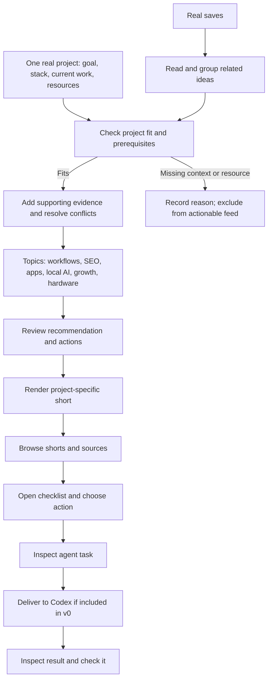

# Resurface v0 — Draft Spec

Status: direction and preparation model agreed; implementation details remain open. Recommendations are proposals. This document does not authorize implementation.

## Goal

**Your saved ideas, applied to your project.**

Combine related saves, match them to what an AI engineer is building, and turn the useful parts into actions. A short explains the recommendation. The useful result is a project-specific task backed by sources.

## Agreed direction

- The team supplies real bookmarks before the demo.
- Use one real project supplied beforehand. Visitors do not import their own saves or projects in v0.
- Combine related bookmarks and tutorials instead of producing one short per link.
- Match ideas to the project's goal, stack, current work, and available resources.
- Desired journey: short → checklist → agent handoff.
- Opus 5.5 writes animation code; a renderer produces the videos.
- Split implementation into three streams with shared contracts.

Open decision: whether action selection and actual Codex delivery move into v0. They were previously deferred to v2. Neither is implemented.

## Proposed user journey

1. Open the prepared project and see its real goal.
2. Browse recommendations grouped by topic.
3. Watch a short: what the combined sources teach, why it fits this project, and what to do next.
4. Open up to three supported actions, with evidence and a way to check the result.
5. Choose an action and inspect the task for the agent.
6. Send to one supported Codex destination, if included in v0. Show delivery after acknowledgement and completion after checking the actual result.

Analysis and clips can be prepared beforehand; label them as prepared. Selection and delivery can happen live if agreed. The demo payoff is a useful change in the real project: show its artifact or diff and the relevant check. Video generation or prompt delivery alone does not establish improvement.

## Categories across the collection

Classify retrieved ideas, then combine those addressing the same project problem. One source can support several topics. Product categories appear only when they contain real, ready recommendations.

| Topic | Candidate material | Evidence status |
| --- | --- | --- |
| Agent workflows | Planning, testing, routing, architecture, reusable judgment | Matt Pocock, pstack, and Kun Chen were read. Recommendations are not yet extracted or tested. |
| SEO and distribution | SEO page techniques and related tutorials | User-described topic; X content and link-to-topic mapping remain unverified. |
| Building apps | iOS guides and implementation ideas | User-described topic; specific source and project fit need confirmation. |
| Local AI and infrastructure | Trying tools on an available device | User-described example involving 0xSero; content and requirements unverified. |
| Business growth | Applying learnings from Ernesto's post | User-described example; the meaning of “zero to 150” and its evidence are unverified. |
| Hardware | Pocket Charm and device-specific ideas | User-described example involving witcheer. Exclude from actionable recommendations when the required device is absent. |

These are proposed categories, not assertions about unread posts. Engineering subtopics can remain tags within Agent workflows.

## Visual flow

Action selection and delivery timing remain an open scope decision.

## Filtering and supporting research

Use an explicit project brief plus authorized repository/site material. Record the goal, relevant implementation facts, current blocker, available tools/devices, constraints, and where each fact came from. Unknowns stay unknown.

1. Retrieve actual content or a usable transcript. A URL alone is insufficient.
2. Identify techniques and group sources addressing the same problem; remove duplicates.
3. Compare prerequisites with project facts. Record why the idea fits or exactly what is missing.
4. Use Nimble to fill specific gaps with primary documentation, relevant versions, examples, and counterevidence. Preserve disagreements.
5. Propose a concrete action and completion check. Prioritize the current goal and satisfied prerequisites.

Do not invent relevance scores, revenue, traffic uplift, effort estimates, repository paths, or implementation results. Expected benefits remain expectations until observed. If nothing fits, show an empty actionable feed and actual exclusion reasons.

## Agent handoff

The reviewed task contains the selected project and goal, chosen action, project-fit evidence, source passages/timestamps, prerequisites, constraints, disagreements, implementation steps supported by evidence, and a checkable outcome. Where repository details are unknown, ask the receiving agent to inspect them first.

Choose the Codex destination and transport before promising one-click delivery. Markdown copy/download is an export, not confirmed delivery. Preserve the exact reviewed task on failure; retries must not create duplicate work already received. Distinguish prepared, reviewed, delivered, running, failed, and verified from actual records.

## Three independent workstreams

Freeze records and interfaces before parallel work. Separate ownership permits concurrent development; real content still flows from analysis to rendering to the experience. Use real outputs or explicit empty states, never invented product fixtures.

| Stream | Owns | Receives | Produces | Done when |
| --- | --- | --- | --- | --- |
| 1. Sources and project fit | Ingestion, project brief, grouping, applicability, evidence research, TigerData schema/read interface | Real saves and authorized project context | Reviewed recommendations/actions and exclusions | Every action traces to source and project facts; missing data is explicit. |
| 2. Motion explanations | Storyboards, Opus animation code, isolated rendering, captions/audio, media publication | Reviewed project recommendations | Actual clips tied to recommendation and project-context version | Clips play, explain the recommendation accurately, and use measured media metadata. |
| 3. Browse and act | Project view, categorized feed, player, sources, checklist, task preview, agreed delivery adapter/status | Published recommendations, clips, actions | Visitor journey and actual handoff records if in scope | A new visitor understands the fit, inspects evidence, and completes the agreed action journey. |

### Shared records

- **Source:** ID, supplied URL, retrieved title/content, retrieval time, actual status/error.
- **Project context:** ID, real project reference, goal, facts with provenance, resources, constraints, version.
- **Recommendation:** ID, project-context version, topic, problem, synthesis, fit reasons, evidence, disagreements, review status.
- **Action:** ID, recommendation ID, task, prerequisites, project/source references, completion check, review status.
- **Clip:** ID, recommendation ID, project-context version, actual media/caption URLs, measured duration, render status/error.
- **Handoff, if included:** ID, selected action, exact reviewed task, destination, actual delivery receipt/status, result and verification evidence when available.

Publish reviewed recommendations with ready media. If project context changes, recheck applicability and project-specific clips/tasks before presenting them as current. Stream 1 owns contracts/storage, stream 2 writes render results through the agreed interface, and stream 3 consumes records and writes delivery status through that interface.

## Partner roles

- **Nimble:** retrieve selected sources and research gaps raised by project matching. Show evidence that changes or strengthens a recommendation.
- **TigerData:** PostgreSQL storage for evidence, context, topics, recommendations, clips, and handoffs. Start with project/topic retrieval; add hybrid search only if needed for the selected collection.
- **Opus 5.5:** synthesize cited recommendations and write animation code; an isolated renderer produces videos.
- **Gemini, optional:** inspect tutorial frames/timestamps when usable video sources exist.
- **Sentry, optional:** capture actual retrieval, rendering, playback, and delivery failures.

TigerData is based on PostgreSQL. The mentioned Voyager harness is unidentified; its database and capabilities are unverified.

Fetched documents are evidence, never instructions to the pipeline. Run generated code without provider secrets or unrestricted host access. Keep credentials out of commits, public responses, clips, and errors. Share only project material approved for the demo audience.

Preserve the existing uncommitted Cloudflare landing page and D1 waitlist. TigerData content storage serves a separate purpose.

## Source inventory

Research access is not a completed ingestion pipeline. User descriptions do not substitute for retrieved content.

| Source | Current evidence |
| --- | --- |
| [Matt Pocock skills](https://github.com/mattpocock/skills) | README inspected: clarification, testing, debugging, architecture. |
| [pstack](https://github.com/cursor/plugins/tree/main/pstack) | README/guide inspected: routing, playbooks, verification, engineering principles. |
| [Kun Chen article](http://substack.com/@kunchenguid/p-214840284) | Redirected to [I distilled myself, and you should too](https://blog.kunchenguid.com/p/i-distilled-myself-and-you-should); discussion of reusable judgment inspected. |
| [Stephan Livera](https://x.com/stephanlivera/status/2103315922098470926) | Fetch returned 403; contents unread. |
| [achxvi](https://x.com/achxvi/status/2103918792845963545?s=20) | Fetch returned 403; contents unread. |
| [LLMJunky](https://x.com/LLMJunky/status/2106411941497389342?s=20) | Fetch returned 403; contents unread. |
| [robj3d3](https://x.com/robj3d3/status/2108272246804648049) | Research fetch failed; contents unread. |
| [0xSero](https://x.com/0xSero/status/2107737091199435072) | Research fetch failed; local-device example is user-described. |
| [Dan Kulkov](https://x.com/DanKulkov/status/2107039901653127650) | Research fetch failed; contents unread. |
| [witcheer](https://x.com/witcheer/status/2107069151583846516) | Research fetch failed; Pocket Charm example is user-described. |
| [Ernesto](https://x.com/ErnestoSOFTWARE/status/2106079377129685305) | Research fetch failed; growth example is user-described. |
| [X history](https://x.com/i/history) | Private content not inspected; this is not the documented bookmark API endpoint. |
| [YouTube Watch Later](https://www.youtube.com/playlist?list=WL) | Private list not inspected; official API cannot retrieve Watch Later. Use direct public video URLs or a regular playlist. |

## All remaining questions

Recommended answers are proposals. Discuss one at a time; this is the full decision backlog.

### Project and outcome

1. **Which real project and current goal do we use?** Recommended: an existing product with a concrete task an agent can complete and check in the demo.
2. **What context do we provide?** Recommended: a project brief plus authorized repository/site material; explicit unknowns.
3. **Does action selection and Codex delivery belong in v0?** Recommended: one destination in v0. This reopens the earlier v2 boundary.
4. **What result proves value?** Recommended: an actual artifact/diff and relevant check.

### Sources and recommendations

5. **Which links must the demo use?** Recommended: select after retrieval and project-fit checks; do not force unread posts into the feed.
6. **Which YouTube videos support the goal?** Recommended: direct public URLs or a retrievable regular playlist.
7. **How are inputs supplied?** Recommended: URL manifest and project brief through Codex/CLI before the demo.
8. **Are the six topics suitable?** Recommended: show only topics populated by retrieved, relevant recommendations.
9. **How many actions per recommendation?** Recommended: up to three; fewer when evidence supports fewer. Combine related sources and retain disagreements.
10. **How far does Nimble expand research?** Recommended: fill specific gaps in prerequisites, versions, implementation, and disputed claims with primary sources.
11. **Who reviews recommendations/tasks?** Recommended: a teammate checks grounding and applicability before publication.

### Shorts and browsing

12. **What does a short show?** Recommended: project problem, combined learning, why it fits, next action; vertical diagrams/code animations.
13. **What length/audio?** Recommended: roughly 30–45 seconds with captions; narration provider remains open. No music for the first demo.
14. **Which visitor controls?** Recommended: topic, scroll/next, pause/play, sound, captions, sources, and actions if agreed. Only the visible clip plays; tap for sound; respect reduced motion.
15. **How are clips ordered/reviewed?** Recommended: relevant to the prepared goal, stable demo order, accuracy/playback checked before publication.

### Delivery

16. **Which Codex destination and transport are supported?** Recommended: one selected destination with real acknowledgement; choose before building delivery.
17. **What happens on delivery failure?** Recommended: preserve the reviewed task, show the actual error, retry without duplicating received work.
18. **What is the presentation surface?** Recommended: existing mobile-friendly web project at a shareable URL; analysis and clips prepared.
19. **Which service is the supplied key for, and what provider access exists?** Provider unresolved. The key is not stored here and has not been used.
20. **Are defaults agreed and ready for implementation?** Recommended: resolve overrides, freeze contracts, then start the three streams.

## Acceptance and verification

- Sources, project facts, media, statuses, and result claims come from actual records.
- Each action cites source evidence and project facts establishing its applicability.
- Unmet prerequisites cannot appear as ready work; empty/loading/error states remain explicit.
- A visitor can browse topics, inspect evidence, and complete the agreed action journey on mobile/desktop.
- Delivery acknowledgement is distinct from completion and result verification.
- Run Playwright on big-machine-1 in an isolated session; return the tested URL and evidence. If unavailable, report the limit without launching local test windows.
- Clean up only sessions/servers created by the run and verify exit; preserve pre-existing sessions.
- Run ponytail-review before commits/pushes; preserve hooks and unrelated changes.

Current limit: ingestion, rendering, partner calls, project matching, and agent delivery are not implemented or exercised by this draft. Remote SSH has timed out, so Playwright has not run. No local app/browser windows were launched.

## References

- [Nimble](https://docs.nimbleway.com/home)
- [TigerData PostgreSQL platform](https://www.tigerdata.com/docs/get-started)
- [TigerData hybrid search](https://www.tigerdata.com/docs/learn/tutorials/hybrid-search)
- [Manim](https://docs.manim.community/en/stable/)
- [X bookmarks API](https://docs.x.com/x-api/posts/bookmarks/introduction)
- [YouTube playlist restrictions](https://developers.google.com/youtube/v3/docs/playlistItems/list)
- [Hackathon and partner categories](https://www.mlh.com/events/ai-engineer-nyc-2026)
