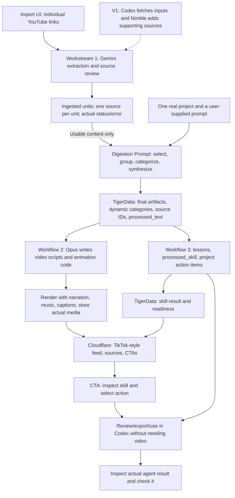

# Resurface — Unified v0 Spec

This is the single canonical product spec. It supersedes the earlier v0 draft and HTML planning preview.

Status: product scope agreed; implementation and database contracts proposed. Workstream 2 now defines its input, timed script, video record, and feed response. This update changes the spec only; migration, provider runs, commits, and deployment require approval.

## Goal

**Your saved ideas, applied to your project.**

Combine related saves, match them to what an AI engineer is building, and turn the useful parts into actions. A short explains the recommendation. The useful result is a project-specific task backed by sources.

## Agreed direction

- V0 accepts individual public YouTube links through a simple import UI. No automatic Watch Later import, X ingestion, or other source formats yet.
- Use one real project supplied beforehand. Visitors can supply video links; project onboarding remains outside v0.
- Combine related tutorials when they address the same problem; do not force unrelated videos into one short.
- Match ideas to the project's goal, stack, current work, and available resources.
- Core v0 journey: import links → see processing/results → browse shorts. The separate skills stream supports short → checklist → agent handoff; its delivery integration remains to be chosen.
- The LLM uses a named **Digestion Prompt** to choose useful material, group it, and produce the shared schema. Categories are dynamic and guided by the user's prompt.
- Shorts are roughly 30–45 seconds, with captions, voice, and music. The team reviews and selects real clips for a stable demo order.
- Opus 5.5 writes animation code; a renderer produces the videos.
- Workflow 1 ingests raw artifacts into a shared TigerData schema.
- Workflow 2 turns processed text into Opus scripts/videos and serves a TikTok-style feed with CTAs on the existing Cloudflare page.
- Workflow 3 independently turns ingested material into processed skills and project action items for Codex.

V1 adds Codex-led source acquisition (give Codex a prompt and have it fetch material) and retrieval of additional supporting sources. That acquisition route is distinct from workflow 3's downstream skill export/handoff.

## Proposed user journey

1. Open the import page for the prepared project. Paste individual YouTube links and supply or edit the Digestion Prompt.
2. Import. Each link shows its actual processing state. An unavailable video shows the failure and the known reason; an unknown reason stays unknown.
3. See the resulting categories and ready artifacts. Categories come from the whole successfully retrieved collection and prompt. Empty or failed inputs remain visible in the import results.
4. Browse the TikTok-style feed. Watch a short explaining the useful learning, its project fit when established, and a next action. Scroll, choose a category, pause, enable sound, read captions, or open sources.
5. Where workflow 3 has a ready skill, inspect the supported action list and export/use the selected task in the agreed Codex destination. Skill generation does not wait for video.

Prepare a small collection of actual videos/clips for the demo and label prepared output. Demonstrate a real import if the provider test passes. A curated URL list or fixed demo order is allowed; fabricated transcripts, media, metrics, and delivery receipts are not. For the action demo, show the actual project artifact/diff and check; generation or prompt delivery alone does not establish improvement.

## Categories

Digestion Prompt derives categories from the successfully extracted collection and the user's prompt. A source can support several topics; related sources may form one artifact. Category names are free text, not an enum. Show only categories with ready, reviewed clips and compute counts from those records. Unsupported material retains its actual exclusion reason.

## Visual flow

Workflows 2 and 3 consume the same ingestion output independently. Workflow 3 never consumes a video or waits for its render.

## Filtering and Digestion Prompt

Use an explicit project brief plus authorized repository/site material. Record the goal, relevant implementation facts, current blocker, available tools/devices, constraints, and where each fact came from. Unknowns stay unknown.

1. Retrieve actual content or a usable transcript. A URL alone is insufficient.
2. Identify techniques and group sources addressing the same problem; remove duplicates.
3. Compare prerequisites with project facts. Record why the idea fits or exactly what is missing.
4. Preserve disagreements and missing prerequisites. V0 uses only the supplied videos; it does not fetch supporting sources. Specific-gap research belongs to V1.
5. Propose a concrete action and completion check. Prioritize the current goal and satisfied prerequisites.

Do not invent relevance scores, revenue, traffic uplift, effort estimates, repository paths, or implementation results. Expected benefits remain expectations until observed. If nothing fits, show an empty actionable feed and actual exclusion reasons.

**Digestion Prompt input:** successfully extracted units, their source IDs and passages/timestamps, the supplied categorization request, the prepared project context, and reviewed few-shot examples when available. One unit is one source artifact; one final artifact may combine several units.

**Digestion Prompt output:** an `artifacts` list containing schema-valid final artifacts with `name`, contributing `source_ids`/URLs, dynamic `category`, source-grounded `processed_text`, evidence references, and a `selection_reason`; plus an `exclusions` list of usable-but-unselected source IDs and reasons, tied to the same prompt revision. Return no artifact when the evidence is insufficient. Failed retrievals retain their extraction errors outside the LLM. Validate both the shape and referenced source IDs before storing; a user's prompt cannot change the output contract or override grounding rules.

The prompt guides recommendation selection as well as grouping. Workflow 1 produces the synthesis/draft narration; workflow 2 uses the team's Opus generation prompt to write a timed script and animation code. Workflow 3 separately produces a skill and actions.

**Prompt refinement tasks:** build real input → reviewed output few-shot examples from the selected videos; include a useful single source, a justified multi-source combination if the collection supports it, and a rejected source. Check unavailable-source handling separately. Record reviewer approval/rejection and the reason, revise the prompt, and rerun the same collection. Do not combine the two selected videos merely to demonstrate multi-source support.

## Three workstreams and ownership

| Workflow | Owns | Input | Output | Independent completion check |
| --- | --- | --- | --- | --- |
| 1. Ingestion | Import UI/API, Gemini extraction and source review, Digestion Prompt, grouping/categories, TigerData schema and contracts | Individual YouTube links, prompt, and authorized project context | Per-source units/errors and reviewed final artifacts | A real video yields usable extracted content and a traceable artifact; unread sources retain actual errors. |
| 2. Video and feed | Opus timed scripts and animation, narration/music/captions, isolated rendering, video results, Cloudflare feed/player and CTAs | Versioned ingestion artifacts with ready processing and approved review | Actual media, video records, and the feed response defined below | A generated clip plays with voice/music/captions on the deployed page using backend data; CTAs reflect actual skill readiness. |
| 3. Skills and actions | Skill generation, project action items, skill review/export, Codex delivery adapter and receipts | Ready ingestion records and project context | Processed skills, action items, actual handoff/result records | A real artifact produces a reviewable skill and executable task that can be used in Codex without any video being generated. |

Workflow 1 owns schema migrations, ingestion writes, and the import screen/module. Workflow 2 owns the feed/player, media pipeline, and deployment wiring; it mounts the import module through an agreed route without rewriting it. Workflow 3 owns skill generation and delivery code and does not edit either screen. Agree exact file ownership before parallel work. Each workflow updates only its own output records, avoiding replacement of another workflow's work.

Freeze the contract, not the category names or prompt wording. Use real retrieved records or explicit empty states, never fabricated product fixtures. Streams 2 and 3 can run independently as soon as workflow 1 publishes a real record.

## Shared TigerData schema

Store **ingested units** separately from **final artifacts**. A unit represents one submitted YouTube video: `id`, original submitted URL, canonical `source_url`, selected start time if supplied, actual retrieved title, `raw_artifact_ref`, extraction method/time, and processing status/error. Keep transcript timestamps when available. Strip Watch Later/list/index parameters from the retrieval URL, while retaining the original submission and selected start time.

The final artifact represents one processed topic, potentially assembled from several units. `processed_text` is the source-grounded content supplied to Opus, which creates the timed video script. `processed_skill` is a separate workflow 3 result; a video script is not a Codex skill.

| Field | Purpose | Writer |
| --- | --- | --- |
| `id` | Stable artifact identity | Workflow 1 |
| `name` | Title of the final processed artifact/topic, grounded in its content | Workflow 1 |
| `source_url` | Original or primary source URL | Workflow 1 |
| `source_ids` | IDs of all contributing ingested units | Workflow 1 |
| `sources` | Every contributing source, with URL, retrieved title, content type, and retrieval time | Workflow 1 |
| `raw_artifact_ref` | Reference to stored raw text/transcript or the original file; preserve evidence | Workflow 1 |
| `processed_text` | Reviewed synthesis/draft narration ready for Opus, with useful lessons and source references | Workflow 1 |
| `category` | Dynamic topic label generated from the collection and user prompt | Workflow 1 |
| `selection_reason` | Source-grounded reason this artifact was selected; keep exclusions separately | Workflow 1 |
| `evidence` | Source passages or video timestamps supporting the synthesis; preserve conflicts | Workflow 1 |
| `project_context_id`, `project_context_version` | Actual project context used for applicability, when the artifact is project-specific | Workflow 1 |
| `version` | Input version tying downstream results to the material they used | Workflow 1 |
| `digestion_prompt_id` | Reference to the stored prompt revision and reviewed few-shot set | Workflow 1 |
| `ingestion_status`, `review_status`, `processed_at`, `error` | Actual processing/review state, timestamp, and failure details | Workflow 1 |
| `video` | Nullable joined video result; never imply media exists before rendering succeeds | Workflow 2 |
| `processed_skill` | Nullable joined skill result/status; Markdown is absent until actually generated | Workflow 3 |

These field names are the proposed shared interface, not invented example data. Separate related output records avoid concurrent writers overwriting each other:

Processing states are `pending`, `running`, `ready`, and `failed`; review states are `pending`, `approved`, and `rejected`, with actual reviewer feedback. Status records can exist before output content. Consumption requires a matching input version, `ready` processing, and `approved` review. Do not mark a unit ready merely because its page metadata was retrieved: the pipeline needs usable source content.

- **Video result:** the `video_results` record defined in workstream 2 below. The artifact's `video` is a joined response field, not a second copy of media metadata.
- **Skill result:** artifact ID/version, project-context version, `skill_markdown`, project `action_items`, supporting references, generation/review status, actual error.
- **Action item:** chosen task, applicability evidence, prerequisites, steps, source references, and a checkable result. Use fewer than three when evidence supports fewer.
- **Handoff:** selected skill/action, exact reviewed payload, destination, delivery status/receipt, result reference, and verification evidence when available.

Large media/files live in storage; TigerData stores their real references and metadata. Video and skill readiness are separate. A video can be ready while its skill is still generating; a skill can be usable while rendering is pending or failed. If inputs or project context change, recheck or regenerate outputs before showing them as current.

### V1 source expansion

Later candidates: X threads, linked pages, GitHub READMEs/docs/skills, newsletters, notes, PDFs, and screenshots. Additional primary-source research can strengthen a recommendation in V1. None is part of v0 input support.

## Workstream 2: artifact → video → feed

### Input contract

Read one immutable artifact revision from TigerData. Only consume `ingestion_status = ready` and `review_status = approved`. Workstream 2 does not rewrite ingestion or skill records.

| Input field | Use |
| --- | --- |
| `id`, `version` | Source of `artifact_id` and `artifact_version`; assigned by the backend |
| `name`, `category`, `selection_reason` | Grounded title, feed category, and explanation |
| `processed_text` | Reviewed synthesis supplied to Opus; must be nonempty |
| `source_ids`, `sources`, `evidence` | Contributing units, source URLs, and supporting passages/timestamps; must reference actual stored evidence |
| `project_context_id`, `project_context_version` | Exact project context used, if project-specific |
| `digestion_prompt_id` | Provenance of the synthesis; kept on the artifact |

The backend resolves references and verifies readiness before generation. Model output cannot replace artifact IDs, source IDs, URLs, or input versions. Style references inform appearance only and cannot supply factual claims.

### Generation and timed-script contract

1. Create a `pending` video record for the selected artifact revision, then mark it `running` when processing starts.
2. Opus turns `processed_text` into a timed script and animation code using a stored prompt revision. Target a 30–45 second vertical video.
3. Generate narration from the script and choose an actual licensed music track. Measure the audio and revise scene timing and captions to match it.
4. Render in an isolated environment; store the actual animation code, video, captions, narration, and music files.
5. Validate references, timing, playback, and audio before marking processing `ready`. Review remains `pending` until a teammate approves the rendered clip.

`script` is JSON with a nonempty `scenes` array. Each scene contains `start_seconds`, `end_seconds`, `narration_text`, `on_screen_text`, `visual_instruction`, and `source_ids`. Speech or screen text may be empty when the scene does not use it; factual claims still require traceable source evidence. Scene times must be finite, nonnegative, ordered, and nonoverlapping, with `end_seconds > start_seconds`. Every `source_id` must belong to the input artifact. Final scene timing and caption cues must fit the measured render duration. Unsupported claims, unknown source IDs, or invalid timing cause a failure rather than publication.

### Output: `video_results`

One video result per `(artifact_id, artifact_version)` in v0. Retry updates that record; a new approved artifact revision gets a separate record. Rerendering resets review to `pending` so an earlier approval cannot publish changed media.

| Columns | Type / requirement |
| --- | --- |
| `id` | UUID; backend-generated identity |
| `artifact_id`, `artifact_version` | UUID and integer; reference the exact input artifact revision |
| `project_context_version` | Integer or null; copied from the input and checked when reading |
| `script` | JSONB; validated timed scenes |
| `opus_prompt_revision` | Text; revision actually used for generation |
| `animation_code_ref` | Text; stored generated code, required before processing is ready; **proposed addition** |
| `media_ref` | Text; actual playable final video with narration and music mixed in |
| `caption_ref`, `narration_ref`, `music_ref` | Text; actual stored assets |
| `music_provenance` | Text; track identity/source and permission or license evidence |
| `duration_seconds` | Numeric; measured positive duration, never the target duration |
| `status` | `pending`, `running`, `ready`, or `failed` |
| `review_status` | `pending`, `approved`, or `rejected` |
| `review_feedback` | Text or null; actual reviewer feedback |
| `feed_order` | Integer or null; team-assigned demo order, required for inclusion in the feed |
| `error` | Text or null; actual safe failure details |
| `created_at`, `updated_at` | Timestamps maintained by the backend on actual writes |

Processing `ready` requires valid script, prompt revision, nonempty code/media/asset references, music provenance, and positive measured duration. A storage reference alone is insufficient: the pipeline must verify the files exist and the final video plays with narration, music, and usable captions. Approval requires review of grounding, readability, pacing, audio balance, and duration. A failed step records `failed` and its actual error; it does not manufacture missing assets.

**Proposed migration changes, not applied:** add `animation_code_ref`; enforce one result per artifact revision; strengthen readiness checks against empty strings and nonpositive duration; and update `artifact_feed` to check project-context versions and expose the fields below. The shared artifact table must support immutable `(id, version)` revisions before this contract is implemented. The current branch migration uses `id` alone as its primary key, so that dependency needs correction by workstream 1.

### Feed read contract

`GET /api/feed` returns an `items` array; no ready clips returns `items: []`. Each item contains `id`, `version`, `name`, `category`, `source_url`, `sources`, `selection_reason`, and:

- `video`: `id`, `media_ref`, `caption_ref`, `duration_seconds`, `feed_order`.
- `skill`: null when no matching result exists; otherwise `id`, `status`, `review_status`. Workstream 3 serves the skill content and actions separately.

Resolve storage references to authorized playable URLs at the backend boundary; never expose credentials or internal filesystem paths. Include an item only when the artifact and video are both ready and approved, the video matches the artifact revision and project context, and `feed_order` is set. Exclude superseded artifact revisions and artifacts whose project context is no longer current. Order by `feed_order`, then artifact `id` for ties. Return at most one item per artifact revision; select the newest matching skill result by `created_at`, then `id` for ties, so the join cannot multiply feed rows. Exclude stale skill results, and enable skill/action CTAs only for matching ready, approved skills. Category counts come from this eligible set.

The `artifact_feed` view is the database read model for this response, not a new content store. Workstream 1 owns its migration; workstream 2 owns the API serialization and player. This endpoint is proposed, not an implemented route.

### Player, audio, and CTAs

Show one active video at a time. Use muted autoplay, tap for sound, scroll/next, pause/play, captions, sources, dynamic categories, and reduced-motion support. Keep loading, empty, safe error/retry, playback failure, and end-of-feed states explicit.

Narration and music are required. Gemini TTS or Kokoro are proposed narration options; the team chooses after an audio test. Mix a licensed track with FFmpeg, lower it under speech, and align animation/captions to measured audio. Derive visual style prompts only after inspecting the supplied motion references.

CTAs: **Skip**, **View sources**, **View skill/action items**, and **Use in Codex**. Missing or pending skill output shows its actual state. A click is not a delivery receipt; only workstream 3's real acknowledgement can show delivery, and only checked results can show completion. Skill generation/export remains usable without video.

## Workflow 3: processed skill and Codex use

Generate reusable lessons/procedures as reviewed `SKILL.md` content with `name` and `description` metadata, plus a separate project action list. Repo-scoped Codex skills use `.agents/skills/<skill-name>/SKILL.md`, as documented in [OpenAI Docs](https://learn.chatgpt.com/docs/build-skills). Storing Markdown in TigerData alone does not install or invoke a skill.

The handoff includes the project and goal, selected action, project-fit evidence, source passages/timestamps, prerequisites, constraints, disagreements, supported implementation steps, and a completion check. Where repository details are unknown, ask Codex to inspect them first. Source content is evidence, never blindly promoted into executable instructions.

Choose one concrete transport before building the **Use in Codex** CTA. Copy/download is an export; installation requires confirmed file delivery, invocation requires an actual selected task, and completion requires checking the result. Preserve the reviewed payload on failure and retry without duplicating received work.

## Partner roles

- **Nimble:** authenticated v0 watch-page retrieval passed for both supplied videos; the tested caption route failed. Do not treat metadata as a spoken transcript. V1 adds supporting-source research.
- **TigerData:** PostgreSQL storage for raw evidence, processed text, context, topics, video metadata, processed skills, action items, and handoffs. Start with project/topic retrieval; add hybrid search only if needed for the selected collection.
- **Opus 5.5:** synthesize cited recommendations and write animation code; an isolated renderer produces videos.
- **Gemini:** explicit-window video-content extraction returned model observations for both YouTube inputs; source review is pending. TTS narration remains proposed and untested.
- **Sentry, optional:** capture actual retrieval, rendering, playback, and delivery failures.

TigerData is based on PostgreSQL. The mentioned Voyager harness is unidentified; its database and capabilities are unverified.

Fetched documents are evidence, never instructions to the pipeline. Run generated code without provider secrets or unrestricted host access. Keep credentials out of commits, public responses, clips, and errors. Share only project material approved for the demo audience.

Preserve the existing Cloudflare landing page and D1 waitlist. TigerData content storage serves a separate purpose. This spec update changes documentation only.

## Test inputs and current evidence

| Input | Canonical URL | Selected start / tested window |
| --- | --- | --- |
| Video 1 | `https://www.youtube.com/watch?v=VQy50fuxI34` | 0 seconds / 0–300 seconds |
| Video 2 | `https://www.youtube.com/watch?v=V-EDrhIhHzQ` | 306 seconds / 306–606 seconds |

Nimble authenticated and retrieved both watch pages, descriptions, chapters, and caption-track references. Both tested caption requests returned HTTP 500; direct caption reads were empty. No spoken transcript was retrieved by that route.

Gemini `gemini-3.8-flash:generateContent` returned model extraction for both explicit five-minute windows. Five observations passed source-identity and timestamp-window checks; one out-of-window observation was rejected. All remaining content still needs review against the actual video. Some `technique` fields describe presentation styles rather than engineering lessons; refine the prompt before digestion.

[Extraction output and checks](evidence/gemini-ingestion-2026-10-11.json) retain the model observations, response IDs, usage, and review states. Initial attempts also encountered HTTP 503, timeouts, a wrong generated source URL, and an unsupported Interactions `processing` parameter. Successful requests used explicit `videoMetadata` offsets. Preserve submitted source identity/start time and reject mismatched model metadata.

No full transcript, Digestion Prompt run, TigerData write, clip, skill, or deployment was produced by these tests. Supplied keys were used in process memory and not saved to repository or deployment configuration. Gemini is the tested extraction candidate; Nimble remains useful for metadata and V1 supporting-web research.

## Open questions

These replace the answered 20-question backlog. Recommended answers remain proposals.

1. **Which prepared project and current goal?** Supply its actual brief and authorized repository/site context. Recommend one task with a checkable result.
2. **Where will production Nimble and Gemini credentials be configured?** Both supplied keys authenticated in isolated tests; neither is stored in repository or deployment configuration. Gemini returned model extraction for the selected windows; source review is pending.
3. **Which provider is the motion/video API key for, and where is the existing Opus generation prompt?** Keep that credential separate from extraction and TTS.
4. **Which narration voice/provider and music track?** Recommend Gemini TTS plus one licensed instrumental track; Kokoro is the open-source alternative.
5. **Who reviews Digestion Prompt output and clips?** Recommend one teammate records approval/rejection with reasons and selects the demo set.
6. **Which Codex destination and delivery route?** Recommend a reviewed skill/task export first; direct delivery needs a real acknowledgement. Confirm whether direct delivery must be in the live v0 demo.
7. **Where are rendered media stored?** Use actual storage URLs and metadata in TigerData. Cloudflare is the presentation surface; choose the media storage service before publishing.

## Approval checkpoints and next work

Run each step past the owner before proceeding. Preparing this spec does not authorize a database write, implementation run, commit/push, or deployment.

1. **Database preflight:** read-only service, connectivity, and existing-schema checks for Tiger Cloud `mlh-aie-hackathon` (`kc5lnts1vn`). The [branch migration](https://github.com/AnalystTom/Major-League-Hacking-Hack-/blob/claude/loving-gates-0xec5o/db/migrations/001_shared_schema.sql) defines nine tables and `artifact_feed`; its live application is unverified.
2. **Schema review:** prepare the migration corrections and the workstream 2 additions above; show the diff before applying anything.
3. **Ingestion and digestion:** review the five candidate observations, refine extraction/few-shot examples, approve the project brief and Digestion Prompt, then validate and store real artifacts.
4. **Workstream 2:** approve the Opus prompt, narration provider, music track, and storage destination. Produce one real clip, review it, then wire the eligible feed response and player.
5. **Workstream 3:** agree one export/delivery route; generate reviewed skills and actions independently from the same artifact revision.
6. **Verification and delivery:** test the approved user journey on big-machine-1, clean up owned test processes, and run ponytail-review before any approved commit/push. Ask separately before deployment.

## Acceptance and verification

- Sources, project facts, media, statuses, and result claims come from actual records.
- Import accepts individual YouTube links, removes playlist-only retrieval parameters, and preserves submitted URLs/start times. Metadata-only retrieval does not count as ingestion.
- A failed source shows the actual failure reason and does not enter synthesis as retrieved evidence.
- Categories come from retrieved content and the supplied prompt; category names are not hardcoded into the schema.
- Digestion Prompt output validates against the shared contract and references actual ingested units. Multi-source grouping needs a supported common topic.
- Published clips have actual voice, music, captions, and measured duration; the team records review decisions.
- Each action cites source evidence and project facts establishing its applicability.
- Unmet prerequisites cannot appear as ready work; empty/loading/error states remain explicit.
- A visitor can browse real videos, inspect sources and skills, and complete the agreed action journey on mobile/desktop.
- Workflow 3 can generate and export a real skill/action list without workflow 2 or any rendered video.
- Separate output writes and artifact/context versions prevent stale results or one workflow overwriting another.
- Delivery acknowledgement is distinct from completion and result verification.
- Run Playwright on big-machine-1 in an isolated session; return the tested URL and evidence. If unavailable, report the limit without launching local test windows.
- Clean up only sessions/servers created by the run and verify exit; preserve pre-existing sessions.
- Run ponytail-review before commits/pushes; preserve hooks and unrelated changes.

## Last observed deployment and verification limits

On 2026-10-11, the Cloudflare Worker `resurface` served [resurface.thomasmann2001.workers.dev](https://resurface.thomasmann2001.workers.dev/) with static assets and a separate D1 waitlist. Served scripts used sample shorts and browser-only Send state; `/api/feed` returned 404. That observation does not establish a real TigerData-backed feed or Codex delivery, and has not been refreshed for this spec edit.

Remote SSH timed out during the prior verification attempts. No Playwright or independent video review ran, and no local app/browser was launched. Live TigerData schema and migration application remain unchecked. This document contains proposed contracts, not proof of implemented behavior.

## References

- [Nimble](https://docs.nimbleway.com/home)
- [TigerData PostgreSQL platform](https://www.tigerdata.com/docs/get-started)
- [TigerData hybrid search](https://www.tigerdata.com/docs/learn/tutorials/hybrid-search)
- [Manim](https://docs.manim.community/en/stable/)
- [Gemini speech generation](https://ai.google.dev/gemini-api/docs/speech-generation)
- [Gemini YouTube video understanding](https://ai.google.dev/gemini-api/docs/video-understanding)
- [Kokoro open-source TTS](https://github.com/hexgrad/kokoro)
- [FFmpeg audio mixing and ducking](https://ffmpeg.org/ffmpeg-filters.html#sidechaincompress)
- [OpenAI Docs: Codex skills](https://learn.chatgpt.com/docs/build-skills)
- [X bookmarks API](https://docs.x.com/x-api/posts/bookmarks/introduction)
- [YouTube playlist restrictions](https://developers.google.com/youtube/v3/docs/playlistItems/list)
- [Hackathon and partner categories](https://www.mlh.com/events/ai-engineer-nyc-2026)
