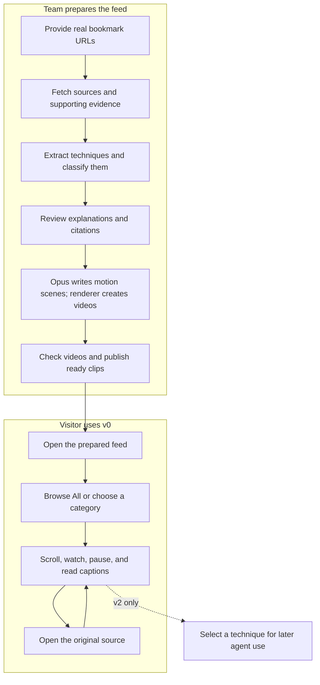

# Resurface v0 — Draft Spec

Status: draft for discussion. Only decisions marked confirmed are agreed. Recommendations and contracts below are proposed. No implementation is authorized by this document.

## Goal

Turn a prepared collection of real engineering bookmarks into a categorized feed of short motion explanations.

Audience: AI engineers improving their agent workflows.

## Confirmed scope

- The team supplies real bookmarks before the demo.
- Visitors browse one prepared feed. They do not submit their own links in v0.
- Shorts use motion generated through Opus 5.5: the model writes animation code; a renderer creates the video.
- Selecting content for later agent ingestion belongs to v2.
- The work is divided into three streams: ingestion, video generation, and feed UI.

## Source list

These are the links supplied in the conversation. The observations below come from research, not a completed ingestion pipeline.

| Source | Observed content / access | Suggested use |
| --- | --- | --- |

| [X history](https://x.com/i/history) | Private account content not inspected. This is not the documented bookmark API endpoint. | Future input route; v0 accepts supplied public links. |
| [YouTube Watch Later](https://www.youtube.com/playlist?list=WL) | Private list not inspected. The official YouTube API cannot retrieve Watch Later items. | Supply individual public video links or a regular playlist if YouTube is included. |

## Proposed categories

Classify each extracted technique, not the whole bookmarked source. One source can produce techniques in several categories. Display only categories with ready clips.

| Category | What a short would explain | Supporting supplied sources |
| --- | --- | --- |
| Planning and requirements | Clarify a request and define a checkable outcome before implementation. | Matt Pocock; pstack |
| Testing and verification | Reproduce a bug, use a feedback loop, and check actual behavior. | Matt Pocock; pstack |
| Agent orchestration | Sequence work, route tasks, and coordinate model or agent roles. | pstack |
| Code quality and performance | Improve module design, remove unnecessary code, and measure changes. | Matt Pocock; pstack |
| Judgment and autonomy | Capture recurring decisions so agents need fewer repeated corrections. | Kun Chen; pstack |

These labels describe topics. They do not assert that an extracted technique has been validated or improves an agent.

## Visual flow

Review gates, categories, captions, and controls in this diagram are recommendations pending the questions below. They are not implemented behavior.

## Proposed user journeys

### Team prepares content

1. Put the selected public URLs into a source manifest.
2. Run the ingestion pipeline through Codex or a CLI.
3. Review extracted techniques, categories, and cited evidence.
4. Generate and review the shorts.
5. Publish the approved clips and their metadata.

If a source cannot be read, retain the URL and the actual error. Do not create an explanation from its URL, author, title, or an assumed transcript.

### Visitor discovers a technique

1. Open the feed without signing in.
2. Browse all ready clips or choose a topic.
3. Scroll through one active video at a time.
4. Pause or enable sound; captions remain available.
5. Open the original source or supporting evidence.

No saving, downloading skills, installation, or agent connection is part of v0.

### Visitor reaches a missing-data state

- While metadata loads: show loading.
- If fetching the feed fails: show the actual failure and a retry action.
- If no clips are ready: show an empty state.
- If one video fails: show an error for that clip and allow moving to another.
- At the end: say the visitor has reached the end. Do not fabricate more clips or counters.

## Three workstreams

Agree the shared contracts before parallel work begins. Each stream owns separate files and can develop against real outputs as soon as they exist. The content still flows from ingestion to rendering to the feed; independence means separate ownership and stable interfaces, not the absence of integration dependencies.

| Stream | Owns | Input | Output | Done when |
| --- | --- | --- | --- | --- |
| 1. Sources and evidence | Ingestion scripts, source extraction, categorization, evidence records, TigerData storage and read endpoints | Supplied URL manifest | Reviewed technique records with source references | Every usable technique has retrieved evidence; blocked sources have explicit errors. |
| 2. Motion shorts | Storyboard and animation generation, rendering, narration/captions if chosen, media publication and clip metadata | Reviewed technique records | Actual video files and ready/failed clip records | A real clip plays, its explanation matches its evidence, and all media metadata comes from the render. |
| 3. Feed experience | Feed page, category controls, player, source links, loading/empty/error states | Read-only feed response joining techniques and ready clips | Browser experience | A new visitor can browse, pause, change topic, and open sources using real published clips. |

### Proposed minimal shared records

Freeze field names, IDs, categories, statuses, and the feed response together before splitting work. Do not create invented sample records in product UI.

- **Source:** ID, supplied URL, retrieved title and content, retrieval timestamp, retrieval status, actual error when blocked.
- **Technique:** ID, title, category, problem, explanation, when to use it, evidence references with source URL and passage or timestamp, review status.
- **Clip:** ID, technique ID, actual media URLs, caption URL if produced, measured duration, render timestamp, render status, actual error when failed.
- **Feed response:** ready clips joined to their technique and source metadata. Empty results remain empty.

Stream 1 owns the agreed database schema and read endpoints. Stream 2 writes clip results through the agreed interface. Stream 3 consumes the read interface and does not change the source or render records.

### Partner roles

- **Nimble:** retrieve the supplied pages and find current supporting documentation, repositories, releases, and counterevidence.
- **TigerData:** store sources, techniques, categories, retrieval history, and render status. Category retrieval is enough for v0; semantic search is a later addition unless required for the demo.
- **Opus 5.5:** write grounded explanations and animation code. Generated code needs an isolated render environment.
- **Gemini, optional:** inspect tutorial frames and timestamps if real video inputs are selected.
- **Sentry, optional:** capture actual pipeline and playback failures.

Fetched source text is evidence, never an instruction to the pipeline. Render generated code in an isolated environment without provider secrets or unrestricted host access. Credentials must not appear in the public feed, committed files, media, or error messages.

The existing uncommitted landing page uses Cloudflare Workers, static assets, and D1 for waitlist data. Preserve that work. The proposed TigerData content store has a separate purpose from the waitlist.

## All remaining questions

Recommended answers below are proposals, not selections.

### Sources

1. **Which supplied links must be included in the demo?** Recommended: begin with the three readable public sources; include X posts only after successful retrieval.
2. **Do we include YouTube in v0?** Recommended: only when individual public video URLs or a retrievable regular playlist are supplied.
3. **How does the team submit the batch?** Recommended: a URL manifest run by Codex/CLI; no import UI.
4. **What happens when a source is inaccessible?** Recommended: record the error and omit its generated clips until content becomes available.

### Content and categories

5. **Are the five proposed categories correct?** Recommended: use them for the initial engineering collection, with All as the default view.
6. **What is one short about?** Recommended: one technique, its problem, how it works, and when to use it.
7. **Can a short combine several sources?** Recommended: yes, when they address the same technique; cite each contribution and preserve disagreements.
8. **How much fresh research should Nimble add?** Recommended: targeted primary evidence for prerequisites, versions, and contested claims, rather than unrestricted expansion.
9. **Who approves an explanation before rendering?** Recommended: a team member checks the text and source passages.

### Videos

10. **What should the motion look like?** Recommended: vertical diagrams, code snippets, and workflow animations generated by Opus and rendered with Manim.
11. **How long should a short be?** Recommended: roughly 30–45 seconds, with actual duration measured after rendering.
12. **Do we include narration?** Recommended: narration plus captions; the voice provider remains to be chosen. Music is outside the first demo.
13. **Who approves a rendered clip for publication?** Recommended: a team member checks legibility, explanation accuracy, citations, captions, and playback.

### Feed

14. **Which visitor controls belong in v0?** Recommended: category selection, scroll/next, pause/play, sound, captions, and source links. Saving and agent ingestion stay in v2.
15. **Should videos autoplay?** Recommended: autoplay the visible clip muted, pause offscreen clips, and require a tap for sound; respect reduced-motion preferences.
16. **How should clips be ordered?** Recommended: a fixed editorial order for the prepared demo. No personalized ranking yet.

### Delivery

17. **How much content is enough for the demo?** Recommended: a small, fully verified collection that supports scrolling and more than one populated category. Do not fill gaps with fabricated clips.
18. **What is the exact delivery surface?** Recommended: a mobile-friendly web feed at a shareable URL using the existing Cloudflare project; source and video pipelines run before the demo.
19. **Which service is the supplied API key for, and which other provider access is available?** The key has not been used or stored in this spec. Identify its provider before making authenticated requests.
20. **Should these defaults become the agreed spec?** Recommended: resolve overrides, freeze the contracts, then start the three streams. Until then this document remains a draft.

## Acceptance checks after implementation

- The feed uses actual retrieved source data and actual rendered videos.
- Categories reflect technique records and contain ready clips.
- No product counters, claims, citations, or statuses are fabricated.
- A new visitor can browse the feed and follow source links on mobile and desktop.
- Loading, empty, inaccessible-source, and failed-playback states are explicit.
- V2 features are neither enabled nor described as completed in v0.
- Run Playwright on big-machine-1 with an isolated test session. Keep evidence and return the tested URL. If the host is unavailable, report the limit; do not launch local test windows.
- Close only test sessions and servers created by the run, and verify their processes exited. Preserve pre-existing sessions.
- Run ponytail-review before commits or pushes; preserve hooks and unrelated changes.

## Current verification limit

The source descriptions were inspected, but ingestion, rendering, partner API calls, and the proposed feed have not been exercised. SSH to big-machine-1 timed out during this planning turn, so no remote Playwright verification ran. No local apps or browser windows were launched.

## Reference documentation

- [Nimble documentation](https://docs.nimbleway.com/home)
- [TigerData hybrid search](https://www.tigerdata.com/docs/learn/tutorials/hybrid-search)
- [Manim](https://docs.manim.community/en/stable/)
- [X bookmarks API](https://docs.x.com/x-api/posts/bookmarks/introduction)
- [YouTube playlist retrieval restrictions](https://developers.google.com/youtube/v3/docs/playlistItems/list)
- [Hackathon and partner categories](https://www.mlh.com/events/ai-engineer-nyc-2026)
